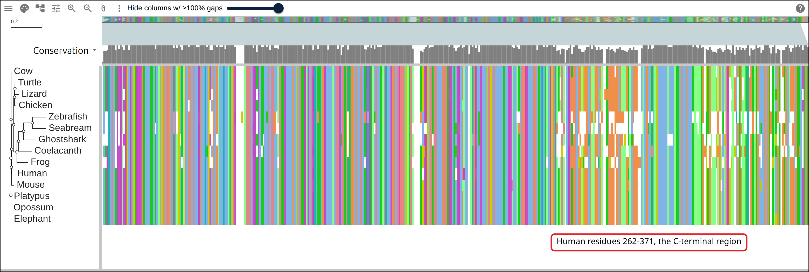
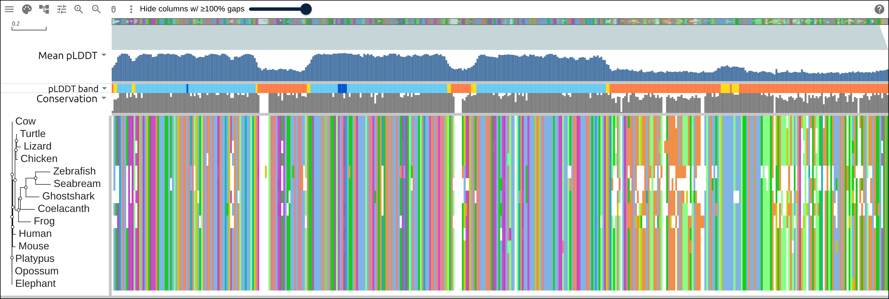
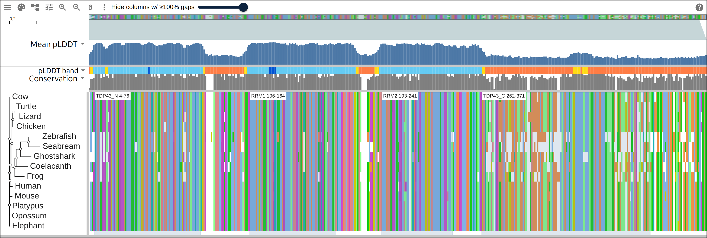
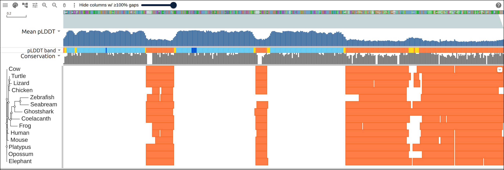
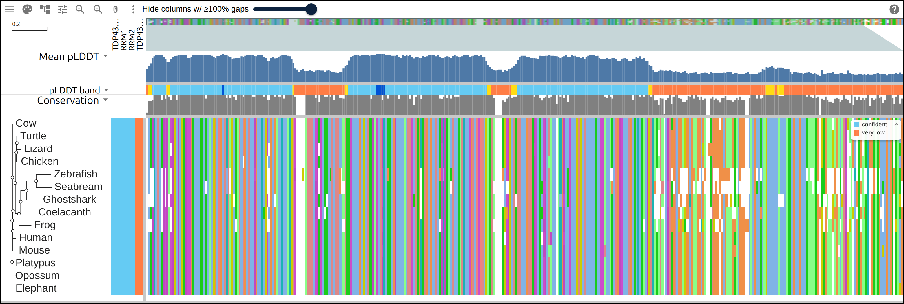
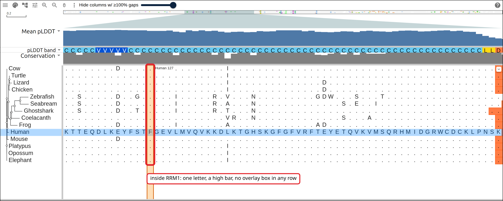
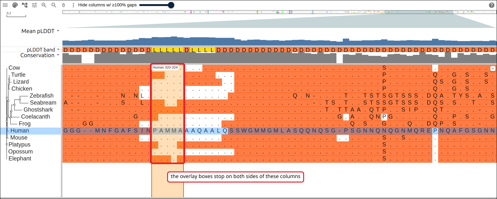
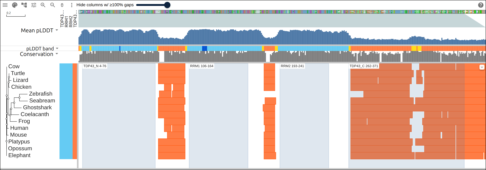

# AlphaFold confidence across a protein family

AlphaFold scores every residue it models with pLDDT, a confidence from 0 to 100
that AlphaFold DB bands as very high (above 90), confident (70 to 90), low (50
to 70) and very low (below 50). TDP-43, the protein the _TARDBP_ gene encodes,
has three folded domains and a 150-residue C-terminal region, so its models
score at both ends of that range, and the folded domains should score high in
every model. For fourteen vertebrate TDP-43 orthologs, we:

- fetch the UniProt sequences, align them and infer a tree
- read the pLDDT from each AlphaFold model and add the mean per column as a
  track in AlphaFold DB's colors
- mark the Pfam domains and add three rows' own pLDDT as strips
- count each row's residues under 50 beside the tree
- check two columns against the model files and open the result

## Prerequisites

- `curl`
- ClustalW, `apt install clustalw` on Debian or Ubuntu, `brew install clustal-w`
  on macOS. ClustalW both aligns and infers a tree, so this page needs no other
  aligner.
- python3, standard library only

## The data

Fourteen UniProtKB entries and their AlphaFold models. AlphaFold DB is keyed on
UniProt accession, so one accession fetches the sequence and the model both.
Nothing to download: the commands below fetch these.

| What it is                                                                      | File                                                                                                        |
| ------------------------------------------------------------------------------- | ----------------------------------------------------------------------------------------------------------- |
| Every sequence in one request, shown here with two of the fourteen accessions   | [uniprotkb-accessions](https://rest.uniprot.org/uniprotkb/accessions?accessions=Q13148,Q921F2&format=fasta) |
| One AlphaFold record per accession, which names its files, for example          | [Q13148](https://alphafold.ebi.ac.uk/api/prediction/Q13148)                                                 |
| The model that record names, whose B-factor column holds the pLDDT, for example | [AF-Q13148-F1-model_v6.pdb](https://alphafold.ebi.ac.uk/files/AF-Q13148-F1-model_v6.pdb)                    |
| The Pfam matches of the human sequence                                          | [Q13148](https://www.ebi.ac.uk/interpro/api/entry/pfam/protein/uniprot/Q13148)                              |

<details>
<summary>The files this page writes, hosted for the figure links</summary>

| What it is                                                 | File                                                                                   |
| ---------------------------------------------------------- | -------------------------------------------------------------------------------------- |
| The row table the commands below start from                | [tardbp-rows.tsv](https://gmod.org/JBrowseMSA/demo/data/tdp43/tardbp-rows.tsv)         |
| The alignment they write                                   | [tardbp.afa](https://gmod.org/JBrowseMSA/demo/data/tdp43/tardbp.afa)                   |
| Its tree                                                   | [tardbp.nwk](https://gmod.org/JBrowseMSA/demo/data/tdp43/tardbp.nwk)                   |
| Each row's mean pLDDT and count of residues under 50       | [tardbp-rowdata.json](https://gmod.org/JBrowseMSA/demo/data/tdp43/tardbp-rowdata.json) |
| The tracks, highlights and bar panel the links below carry | [tardbp-layers.json](https://gmod.org/JBrowseMSA/demo/data/tdp43/tardbp-layers.json)   |

</details>

## 1. Name the rows

Write one species per line: the label the viewer draws, then the UniProtKB
accession. The label becomes the FASTA defline, the tree tip and the `row` of
every layer.

```
Human	Q13148
Mouse	Q921F2
Cow	G3MX91
Elephant	G3TD75
Opossum	A0A5F8GU32
Platypus	F7EDX1
Chicken	Q5ZLN5
Turtle	K7FJ67
Lizard	A0A670IXJ6
Frog	Q28F51
Coelacanth	H3BC22
Zebrafish	Q802C7
Seabream	A0A671WI33
Ghostshark	A0A4W3GN84
```

Both teleost entries are the `tardbpb` paralog, which runs the full length of
the protein.

## 2. Fetch the sequences

One request takes every accession, and a short script rewrites each defline to
the species label:

```bash
accessions=$(awk -F'\t' '{printf "%s%s", sep, $2; sep=","}' rows.tsv)
curl -sf "https://rest.uniprot.org/uniprotkb/accessions?accessions=$accessions&format=fasta" \
  -o tardbp-uniprot.fasta
```

```
  Human        Q13148       414 aa
  Mouse        Q921F2       414 aa
  Cow          G3MX91       414 aa
  Elephant     G3TD75       414 aa
  Opossum      A0A5F8GU32   414 aa
  Platypus     F7EDX1       414 aa
  Chicken      Q5ZLN5       414 aa
  Turtle       K7FJ67       414 aa
  Lizard       A0A670IXJ6   415 aa
  Frog         Q28F51       409 aa
  Coelacanth   H3BC22       412 aa
  Zebrafish    Q802C7       412 aa
  Seabream     A0A671WI33   406 aa
  Ghostshark   A0A4W3GN84   404 aa
```

## 3. Align and infer a tree

ClustalW aligns the sequences in input order and infers a neighbor-joining tree:

```bash
clustalw -INFILE=tardbp.fasta -ALIGN -TYPE=PROTEIN -OUTORDER=INPUT \
  -OUTPUT=FASTA -OUTFILE=tardbp.afa
clustalw -INFILE=tardbp.afa -TREE -TYPE=PROTEIN -OUTPUTTREE=phylip
tr -d '[:space:]' < tardbp.ph > tardbp.nwk
```

```
14 rows, 431 columns
(((((Human:0.01799,((Chicken:0.01026,(Turtle:0.00330,Lizard:0.02575):0.00303):0.00546,
(Frog:0.07202,(Coelacanth:0.08469,((Zebrafish:0.08572,Seabream:0.08841):0.05655,
Ghostshark:0.07870):0.03228):0.01066):0.02077):0.01299):0.00134,Mouse:0.01773):0.00213,
Cow:0.00108):0.00132,Platypus:0.00236):0.00000,Elephant:0.00238,Opossum:0.00000);
```

[](https://gmod.org/JBrowseMSA/demo/#data=%7B%22msaview%22%3A%7B%22type%22%3A%22MsaView%22%2C%22height%22%3A520%2C%22treeAreaWidth%22%3A190%2C%22colWidth%22%3A3.2%2C%22rowHeight%22%3A22%2C%22residueColor%22%3A%7B%22scale%22%3A%7B%22scheme%22%3A%22clustalx_protein_dynamic%22%7D%7D%2C%22turnedOffTracks%22%3A%7B%22property-conservation%22%3Atrue%7D%2C%22msaFilehandle%22%3A%7B%22uri%22%3A%22data%2Ftdp43%2Ftardbp.afa%22%7D%2C%22treeFilehandle%22%3A%7B%22uri%22%3A%22data%2Ftdp43%2Ftardbp.nwk%22%7D%7D%7D)

Fourteen rows of 431 columns, 387 of which have a residue in every row. The gaps
cluster in the right third, right of the C-terminal callout. The mammal rows sit
on branches of 0.001 to 0.02 substitutions per site, and on those distances
neighbor joining places Human beside the sauropsids, outside the other mammals.

## 4. Read the pLDDT from the models

The AlphaFold API record for each accession names its model file. Send a
`User-Agent` header, since the API answers a request without one with a 403:

```bash
url=$(curl -sf -A "$UA" "https://alphafold.ebi.ac.uk/api/prediction/Q13148" |
  python3 -c 'import json,sys; print(json.load(sys.stdin)[0]["pdbUrl"])')
curl -sf -A "$UA" "$url" -o models/Q13148.pdb
```

AlphaFold writes each residue's pLDDT into the B-factor column of its CA atom,
beside the residue name, so one pass reads the model's sequence and confidence
together:

```python
def read_model(path):
    seq, plddt = '', []
    for line in open(path):
        if line.startswith('ATOM') and line[12:16].strip() == 'CA':
            seq += THREE_TO_ONE[line[17:20]]
            plddt.append(float(line[60:66]))
    return seq, plddt
```

A model follows the UniProt sequence of the day it was built, so the script
compares it to the row letter by letter first:

```
  Human        Q13148       model 414 aa matches the row, mean pLDDT  65.2, 156 residues under 50
  Mouse        Q921F2       model 414 aa matches the row, mean pLDDT  63.8, 162 residues under 50
  Cow          G3MX91       model 414 aa matches the row, mean pLDDT  61.6, 172 residues under 50
  Elephant     G3TD75       model 414 aa matches the row, mean pLDDT  62.0, 178 residues under 50
  Opossum      A0A5F8GU32   model 414 aa matches the row, mean pLDDT  62.4, 169 residues under 50
  Platypus     F7EDX1       model 414 aa matches the row, mean pLDDT  61.9, 175 residues under 50
  Chicken      Q5ZLN5       model 414 aa matches the row, mean pLDDT  65.8, 155 residues under 50
  Turtle       K7FJ67       model 414 aa matches the row, mean pLDDT  61.4, 175 residues under 50
  Lizard       A0A670IXJ6   model 415 aa matches the row, mean pLDDT  62.3, 173 residues under 50
  Frog         Q28F51       model 409 aa matches the row, mean pLDDT  66.5, 156 residues under 50
  Coelacanth   H3BC22       model 412 aa matches the row, mean pLDDT  61.5, 167 residues under 50
  Zebrafish    Q802C7       model 412 aa matches the row, mean pLDDT  65.9, 149 residues under 50
  Seabream     A0A671WI33   model 406 aa matches the row, mean pLDDT  61.6, 170 residues under 50
  Ghostshark   A0A4W3GN84   model 404 aa matches the row, mean pLDDT  62.0, 172 residues under 50
```

Every model matches its row. The column track holds the rounded mean over the
rows with a residue in each column:

```python
means = [round(sum(values) / len(values)) for values in by_column]
```

```
columns by mean pLDDT band: 6 very high, 214 confident, 24 low, 187 very low
```

A threshold scale colors each bar by the band its value falls in. `domain` holds
the three cuts and `range` the four colors AlphaFold DB draws its models in,
lowest first, and `legend.labels` names the four intervals:

```json
"encoding": {
  "y": { "scale": { "domainMax": 100 } },
  "color": {
    "scale": {
      "type": "threshold",
      "domain": [50, 70, 90],
      "range": ["#ff7d45", "#ffdb13", "#65cbf3", "#0053d6"]
    },
    "legend": {
      "title": "pLDDT",
      "labels": ["Very low", "Low", "Confident", "Very high"]
    }
  }
}
```

A `range` of any length but four draws what it can, and `model.scaleProblems`
names the record and the member.

[](https://gmod.org/JBrowseMSA/demo/#data=%7B%22msaview%22%3A%7B%22type%22%3A%22MsaView%22%2C%22height%22%3A520%2C%22treeAreaWidth%22%3A190%2C%22colWidth%22%3A3.2%2C%22rowHeight%22%3A22%2C%22residueColor%22%3A%7B%22scale%22%3A%7B%22scheme%22%3A%22clustalx_protein_dynamic%22%7D%7D%2C%22turnedOffTracks%22%3A%7B%22property-conservation%22%3Atrue%7D%2C%22msaFilehandle%22%3A%7B%22uri%22%3A%22data%2Ftdp43%2Ftardbp.afa%22%7D%2C%22treeFilehandle%22%3A%7B%22uri%22%3A%22data%2Ftdp43%2Ftardbp.nwk%22%7D%2C%22columnTracks%22%3A%5B%7B%22id%22%3A%22plddt-mean%22%2C%22name%22%3A%22Mean%20pLDDT%22%2C%22kind%22%3A%22bar%22%2C%22values%22%3A%5B48%2C55%2C63%2C80%2C84%2C89%2C89%2C89%2C88%2C83%2C75%2C67%2C68%2C76%2C81%2C85%2C86%2C89%2C88%2C87%2C87%2C87%2C79%2C80%2C81%2C88%2C89%2C89%2C88%2C87%2C89%2C89%2C87%2C88%2C87%2C86%2C82%2C80%2C85%2C85%2C88%2C90%2C89%2C88%2C84%2C81%2C76%2C78%2C80%2C79%2C79%2C84%2C83%2C86%2C89%2C88%2C88%2C87%2C85%2C84%2C89%2C89%2C87%2C83%2C79%2C71%2C71%2C80%2C81%2C78%2C80%2C83%2C86%2C88%2C88%2C88%2C86%2C84%2C76%2C64%2C49%2C46%2C40%2C44%2C47%2C41%2C42%2C42%2C44%2C41%2C40%2C43%2C45%2C44%2C43%2C43%2C39%2C43%2C44%2C41%2C40%2C38%2C37%2C35%2C39%2C40%2C49%2C55%2C60%2C72%2C81%2C85%2C87%2C89%2C87%2C86%2C89%2C87%2C87%2C87%2C86%2C89%2C89%2C89%2C90%2C90%2C90%2C91%2C90%2C89%2C89%2C89%2C86%2C86%2C86%2C88%2C82%2C79%2C89%2C85%2C89%2C85%2C87%2C82%2C78%2C81%2C82%2C79%2C80%2C85%2C83%2C84%2C89%2C89%2C89%2C89%2C84%2C87%2C81%2C80%2C79%2C81%2C84%2C83%2C80%2C85%2C87%2C84%2C83%2C81%2C84%2C87%2C88%2C87%2C83%2C84%2C86%2C88%2C89%2C85%2C87%2C82%2C81%2C70%2C60%2C52%2C47%2C44%2C43%2C44%2C46%2C46%2C40%2C45%2C42%2C47%2C47%2C51%2C55%2C62%2C74%2C83%2C86%2C86%2C86%2C82%2C81%2C80%2C80%2C79%2C78%2C77%2C86%2C85%2C85%2C86%2C86%2C87%2C86%2C86%2C85%2C84%2C83%2C80%2C81%2C84%2C87%2C83%2C81%2C87%2C85%2C86%2C81%2C82%2C80%2C82%2C77%2C81%2C86%2C87%2C89%2C88%2C85%2C86%2C80%2C76%2C76%2C77%2C80%2C77%2C75%2C79%2C79%2C75%2C70%2C71%2C77%2C78%2C79%2C77%2C71%2C71%2C77%2C77%2C83%2C80%2C84%2C77%2C80%2C71%2C70%2C58%2C56%2C44%2C38%2C40%2C41%2C46%2C43%2C42%2C43%2C42%2C44%2C41%2C39%2C42%2C38%2C38%2C36%2C39%2C42%2C35%2C34%2C36%2C36%2C37%2C39%2C34%2C33%2C35%2C36%2C37%2C35%2C33%2C38%2C36%2C36%2C35%2C36%2C36%2C35%2C37%2C35%2C38%2C38%2C38%2C34%2C36%2C35%2C34%2C34%2C32%2C33%2C35%2C38%2C34%2C34%2C34%2C34%2C34%2C37%2C40%2C47%2C46%2C52%2C51%2C52%2C55%2C51%2C48%2C51%2C51%2C51%2C50%2C48%2C48%2C48%2C40%2C34%2C38%2C39%2C37%2C35%2C36%2C33%2C35%2C37%2C38%2C36%2C34%2C35%2C34%2C31%2C28%2C44%2C33%2C33%2C35%2C35%2C36%2C40%2C34%2C33%2C34%2C36%2C35%2C34%2C34%2C43%2C36%2C34%2C33%2C31%2C31%2C32%2C32%2C31%2C34%2C30%2C33%2C31%2C31%2C33%2C33%2C35%2C33%2C33%2C34%2C34%2C29%2C32%2C32%2C33%2C32%2C35%2C34%2C37%2C33%2C35%2C37%2C34%2C35%2C33%2C35%2C34%2C35%2C33%2C36%2C34%2C39%2C37%2C40%2C39%2C40%2C41%2C43%2C45%2C43%2C44%2C52%2C46%5D%2C%22encoding%22%3A%7B%22y%22%3A%7B%22scale%22%3A%7B%22domainMax%22%3A100%7D%7D%2C%22color%22%3A%7B%22scale%22%3A%7B%22type%22%3A%22threshold%22%2C%22domain%22%3A%5B50%2C70%2C90%5D%2C%22range%22%3A%5B%22%23ff7d45%22%2C%22%23ffdb13%22%2C%22%2365cbf3%22%2C%22%230053d6%22%5D%7D%2C%22legend%22%3A%7B%22title%22%3A%22pLDDT%22%2C%22labels%22%3A%5B%22Very%20low%22%2C%22Low%22%2C%22Confident%22%2C%22Very%20high%22%5D%7D%7D%7D%2C%22height%22%3A60%7D%5D%7D%7D)

The mean pLDDT per column as bars in AlphaFold DB's colors. Three light blue
blocks of confident columns sit between two orange dips, and the columns from
272 to the right edge are very low.

## 5. Mark the Pfam domains

InterPro serves the Pfam matches of the human sequence in one request:

```bash
curl -sf https://www.ebi.ac.uk/interpro/api/entry/pfam/protein/uniprot/Q13148 \
  -o tardbp-pfam.json
```

The script writes each match as a highlight on the Human row, in that row's
residue numbering:

```
TDP43_N  PF18694 Human 4-77: columns 5-78, mean pLDDT  84.0
RRM1     PF00076 Human 106-164: columns 112-170, mean pLDDT  85.5
RRM2     PF00076 Human 193-241: columns 203-251, mean pLDDT  82.7
TDP43_C  PF20910 Human 262-371: columns 272-387, mean pLDDT  38.4
```

[](<https://gmod.org/JBrowseMSA/demo/#data=%7B%22msaview%22%3A%7B%22type%22%3A%22MsaView%22%2C%22height%22%3A520%2C%22treeAreaWidth%22%3A190%2C%22colWidth%22%3A3.2%2C%22rowHeight%22%3A22%2C%22residueColor%22%3A%7B%22scale%22%3A%7B%22scheme%22%3A%22clustalx_protein_dynamic%22%7D%7D%2C%22turnedOffTracks%22%3A%7B%22property-conservation%22%3Atrue%7D%2C%22msaFilehandle%22%3A%7B%22uri%22%3A%22data%2Ftdp43%2Ftardbp.afa%22%7D%2C%22treeFilehandle%22%3A%7B%22uri%22%3A%22data%2Ftdp43%2Ftardbp.nwk%22%7D%2C%22columnTracks%22%3A%5B%7B%22id%22%3A%22plddt-mean%22%2C%22name%22%3A%22Mean%20pLDDT%22%2C%22kind%22%3A%22bar%22%2C%22values%22%3A%5B48%2C55%2C63%2C80%2C84%2C89%2C89%2C89%2C88%2C83%2C75%2C67%2C68%2C76%2C81%2C85%2C86%2C89%2C88%2C87%2C87%2C87%2C79%2C80%2C81%2C88%2C89%2C89%2C88%2C87%2C89%2C89%2C87%2C88%2C87%2C86%2C82%2C80%2C85%2C85%2C88%2C90%2C89%2C88%2C84%2C81%2C76%2C78%2C80%2C79%2C79%2C84%2C83%2C86%2C89%2C88%2C88%2C87%2C85%2C84%2C89%2C89%2C87%2C83%2C79%2C71%2C71%2C80%2C81%2C78%2C80%2C83%2C86%2C88%2C88%2C88%2C86%2C84%2C76%2C64%2C49%2C46%2C40%2C44%2C47%2C41%2C42%2C42%2C44%2C41%2C40%2C43%2C45%2C44%2C43%2C43%2C39%2C43%2C44%2C41%2C40%2C38%2C37%2C35%2C39%2C40%2C49%2C55%2C60%2C72%2C81%2C85%2C87%2C89%2C87%2C86%2C89%2C87%2C87%2C87%2C86%2C89%2C89%2C89%2C90%2C90%2C90%2C91%2C90%2C89%2C89%2C89%2C86%2C86%2C86%2C88%2C82%2C79%2C89%2C85%2C89%2C85%2C87%2C82%2C78%2C81%2C82%2C79%2C80%2C85%2C83%2C84%2C89%2C89%2C89%2C89%2C84%2C87%2C81%2C80%2C79%2C81%2C84%2C83%2C80%2C85%2C87%2C84%2C83%2C81%2C84%2C87%2C88%2C87%2C83%2C84%2C86%2C88%2C89%2C85%2C87%2C82%2C81%2C70%2C60%2C52%2C47%2C44%2C43%2C44%2C46%2C46%2C40%2C45%2C42%2C47%2C47%2C51%2C55%2C62%2C74%2C83%2C86%2C86%2C86%2C82%2C81%2C80%2C80%2C79%2C78%2C77%2C86%2C85%2C85%2C86%2C86%2C87%2C86%2C86%2C85%2C84%2C83%2C80%2C81%2C84%2C87%2C83%2C81%2C87%2C85%2C86%2C81%2C82%2C80%2C82%2C77%2C81%2C86%2C87%2C89%2C88%2C85%2C86%2C80%2C76%2C76%2C77%2C80%2C77%2C75%2C79%2C79%2C75%2C70%2C71%2C77%2C78%2C79%2C77%2C71%2C71%2C77%2C77%2C83%2C80%2C84%2C77%2C80%2C71%2C70%2C58%2C56%2C44%2C38%2C40%2C41%2C46%2C43%2C42%2C43%2C42%2C44%2C41%2C39%2C42%2C38%2C38%2C36%2C39%2C42%2C35%2C34%2C36%2C36%2C37%2C39%2C34%2C33%2C35%2C36%2C37%2C35%2C33%2C38%2C36%2C36%2C35%2C36%2C36%2C35%2C37%2C35%2C38%2C38%2C38%2C34%2C36%2C35%2C34%2C34%2C32%2C33%2C35%2C38%2C34%2C34%2C34%2C34%2C34%2C37%2C40%2C47%2C46%2C52%2C51%2C52%2C55%2C51%2C48%2C51%2C51%2C51%2C50%2C48%2C48%2C48%2C40%2C34%2C38%2C39%2C37%2C35%2C36%2C33%2C35%2C37%2C38%2C36%2C34%2C35%2C34%2C31%2C28%2C44%2C33%2C33%2C35%2C35%2C36%2C40%2C34%2C33%2C34%2C36%2C35%2C34%2C34%2C43%2C36%2C34%2C33%2C31%2C31%2C32%2C32%2C31%2C34%2C30%2C33%2C31%2C31%2C33%2C33%2C35%2C33%2C33%2C34%2C34%2C29%2C32%2C32%2C33%2C32%2C35%2C34%2C37%2C33%2C35%2C37%2C34%2C35%2C33%2C35%2C34%2C35%2C33%2C36%2C34%2C39%2C37%2C40%2C39%2C40%2C41%2C43%2C45%2C43%2C44%2C52%2C46%5D%2C%22encoding%22%3A%7B%22y%22%3A%7B%22scale%22%3A%7B%22domainMax%22%3A100%7D%7D%2C%22color%22%3A%7B%22scale%22%3A%7B%22type%22%3A%22threshold%22%2C%22domain%22%3A%5B50%2C70%2C90%5D%2C%22range%22%3A%5B%22%23ff7d45%22%2C%22%23ffdb13%22%2C%22%2365cbf3%22%2C%22%230053d6%22%5D%7D%2C%22legend%22%3A%7B%22title%22%3A%22pLDDT%22%2C%22labels%22%3A%5B%22Very%20low%22%2C%22Low%22%2C%22Confident%22%2C%22Very%20high%22%5D%7D%7D%7D%2C%22height%22%3A60%7D%5D%2C%22highlights%22%3A%5B%7B%22row%22%3A%22Human%22%2C%22start%22%3A4%2C%22end%22%3A77%2C%22label%22%3A%22TDP43_N%204-77%22%2C%22color%22%3A%22rgba(78%2C121%2C167%2C0.18)%22%7D%2C%7B%22row%22%3A%22Human%22%2C%22start%22%3A106%2C%22end%22%3A164%2C%22label%22%3A%22RRM1%20106-164%22%2C%22color%22%3A%22rgba(78%2C121%2C167%2C0.18)%22%7D%2C%7B%22row%22%3A%22Human%22%2C%22start%22%3A193%2C%22end%22%3A241%2C%22label%22%3A%22RRM2%20193-241%22%2C%22color%22%3A%22rgba(78%2C121%2C167%2C0.18)%22%7D%2C%7B%22row%22%3A%22Human%22%2C%22start%22%3A262%2C%22end%22%3A371%2C%22label%22%3A%22TDP43_C%20262-371%22%2C%22color%22%3A%22rgba(78%2C121%2C167%2C0.18)%22%7D%5D%7D%7D>)

The four Pfam matches (TDP43_N, RRM1, RRM2 and TDP43_C) as blue bands over the
alignment, under the mean pLDDT track. The first three bands sit under confident
columns and the fourth under very low ones.

## 6. Add three rows' own pLDDT

A `strip` track with `row` set draws one cell per residue of that row, and the
viewer places each cell through the row's gaps. The script writes one for the
reference row, the row with the fewest residues under 50 and the row with the
longest run under 50, each reading the model's pLDDT through the color object of
step 4:

```python
{'id': f'plddt-{label.lower()}', 'name': f'{label} pLDDT', 'kind': 'strip',
 'row': label, 'values': plddt[label], 'encoding': {'color': PLDDT}}
```

```
strips for Human, Zebrafish with the fewest residues under 50 and Ghostshark with the longest run under 50
  Human        runs of 5 or more under 50 at columns 87-93, 95-106, 188-197, 274-334, 347-378, 380-424
  Zebrafish    runs of 5 or more under 50 at columns 82-93, 95-106, 287-332, 347-427
  Ghostshark   runs of 5 or more under 50 at columns 81-106, 186-197, 274-431
```

The list keeps runs of five or more residues, so it leaves out the Zebrafish
strip's second dip, where one residue at or above 50 splits the run.

[](https://gmod.org/JBrowseMSA/demo/#data=%7B%22msaview%22%3A%7B%22type%22%3A%22MsaView%22%2C%22height%22%3A540%2C%22treeAreaWidth%22%3A190%2C%22colWidth%22%3A3.2%2C%22rowHeight%22%3A22%2C%22residueColor%22%3A%7B%22scale%22%3A%7B%22scheme%22%3A%22clustalx_protein_dynamic%22%7D%7D%2C%22turnedOffTracks%22%3A%7B%22property-conservation%22%3Atrue%7D%2C%22msaFilehandle%22%3A%7B%22uri%22%3A%22data%2Ftdp43%2Ftardbp.afa%22%7D%2C%22treeFilehandle%22%3A%7B%22uri%22%3A%22data%2Ftdp43%2Ftardbp.nwk%22%7D%2C%22columnTracks%22%3A%5B%7B%22id%22%3A%22plddt-mean%22%2C%22name%22%3A%22Mean%20pLDDT%22%2C%22kind%22%3A%22bar%22%2C%22values%22%3A%5B48%2C55%2C63%2C80%2C84%2C89%2C89%2C89%2C88%2C83%2C75%2C67%2C68%2C76%2C81%2C85%2C86%2C89%2C88%2C87%2C87%2C87%2C79%2C80%2C81%2C88%2C89%2C89%2C88%2C87%2C89%2C89%2C87%2C88%2C87%2C86%2C82%2C80%2C85%2C85%2C88%2C90%2C89%2C88%2C84%2C81%2C76%2C78%2C80%2C79%2C79%2C84%2C83%2C86%2C89%2C88%2C88%2C87%2C85%2C84%2C89%2C89%2C87%2C83%2C79%2C71%2C71%2C80%2C81%2C78%2C80%2C83%2C86%2C88%2C88%2C88%2C86%2C84%2C76%2C64%2C49%2C46%2C40%2C44%2C47%2C41%2C42%2C42%2C44%2C41%2C40%2C43%2C45%2C44%2C43%2C43%2C39%2C43%2C44%2C41%2C40%2C38%2C37%2C35%2C39%2C40%2C49%2C55%2C60%2C72%2C81%2C85%2C87%2C89%2C87%2C86%2C89%2C87%2C87%2C87%2C86%2C89%2C89%2C89%2C90%2C90%2C90%2C91%2C90%2C89%2C89%2C89%2C86%2C86%2C86%2C88%2C82%2C79%2C89%2C85%2C89%2C85%2C87%2C82%2C78%2C81%2C82%2C79%2C80%2C85%2C83%2C84%2C89%2C89%2C89%2C89%2C84%2C87%2C81%2C80%2C79%2C81%2C84%2C83%2C80%2C85%2C87%2C84%2C83%2C81%2C84%2C87%2C88%2C87%2C83%2C84%2C86%2C88%2C89%2C85%2C87%2C82%2C81%2C70%2C60%2C52%2C47%2C44%2C43%2C44%2C46%2C46%2C40%2C45%2C42%2C47%2C47%2C51%2C55%2C62%2C74%2C83%2C86%2C86%2C86%2C82%2C81%2C80%2C80%2C79%2C78%2C77%2C86%2C85%2C85%2C86%2C86%2C87%2C86%2C86%2C85%2C84%2C83%2C80%2C81%2C84%2C87%2C83%2C81%2C87%2C85%2C86%2C81%2C82%2C80%2C82%2C77%2C81%2C86%2C87%2C89%2C88%2C85%2C86%2C80%2C76%2C76%2C77%2C80%2C77%2C75%2C79%2C79%2C75%2C70%2C71%2C77%2C78%2C79%2C77%2C71%2C71%2C77%2C77%2C83%2C80%2C84%2C77%2C80%2C71%2C70%2C58%2C56%2C44%2C38%2C40%2C41%2C46%2C43%2C42%2C43%2C42%2C44%2C41%2C39%2C42%2C38%2C38%2C36%2C39%2C42%2C35%2C34%2C36%2C36%2C37%2C39%2C34%2C33%2C35%2C36%2C37%2C35%2C33%2C38%2C36%2C36%2C35%2C36%2C36%2C35%2C37%2C35%2C38%2C38%2C38%2C34%2C36%2C35%2C34%2C34%2C32%2C33%2C35%2C38%2C34%2C34%2C34%2C34%2C34%2C37%2C40%2C47%2C46%2C52%2C51%2C52%2C55%2C51%2C48%2C51%2C51%2C51%2C50%2C48%2C48%2C48%2C40%2C34%2C38%2C39%2C37%2C35%2C36%2C33%2C35%2C37%2C38%2C36%2C34%2C35%2C34%2C31%2C28%2C44%2C33%2C33%2C35%2C35%2C36%2C40%2C34%2C33%2C34%2C36%2C35%2C34%2C34%2C43%2C36%2C34%2C33%2C31%2C31%2C32%2C32%2C31%2C34%2C30%2C33%2C31%2C31%2C33%2C33%2C35%2C33%2C33%2C34%2C34%2C29%2C32%2C32%2C33%2C32%2C35%2C34%2C37%2C33%2C35%2C37%2C34%2C35%2C33%2C35%2C34%2C35%2C33%2C36%2C34%2C39%2C37%2C40%2C39%2C40%2C41%2C43%2C45%2C43%2C44%2C52%2C46%5D%2C%22encoding%22%3A%7B%22y%22%3A%7B%22scale%22%3A%7B%22domainMax%22%3A100%7D%7D%2C%22color%22%3A%7B%22scale%22%3A%7B%22type%22%3A%22threshold%22%2C%22domain%22%3A%5B50%2C70%2C90%5D%2C%22range%22%3A%5B%22%23ff7d45%22%2C%22%23ffdb13%22%2C%22%2365cbf3%22%2C%22%230053d6%22%5D%7D%2C%22legend%22%3A%7B%22title%22%3A%22pLDDT%22%2C%22labels%22%3A%5B%22Very%20low%22%2C%22Low%22%2C%22Confident%22%2C%22Very%20high%22%5D%7D%7D%7D%2C%22height%22%3A60%7D%2C%7B%22id%22%3A%22plddt-human%22%2C%22name%22%3A%22Human%20pLDDT%22%2C%22kind%22%3A%22strip%22%2C%22row%22%3A%22Human%22%2C%22values%22%3A%5B51.47%2C63.25%2C79.25%2C83.44%2C87.06%2C87.62%2C87.88%2C87.81%2C84.06%2C75.5%2C68.69%2C69%2C76.88%2C81.44%2C83.94%2C85.69%2C87.44%2C86.62%2C86.25%2C85%2C86%2C76.94%2C78.12%2C80.12%2C85.94%2C87.12%2C88.38%2C87.06%2C86.94%2C88.25%2C88.31%2C88%2C88.56%2C86.75%2C84.56%2C82.62%2C81.25%2C83.75%2C83.12%2C86.62%2C88.62%2C88.5%2C87.19%2C83.5%2C79.25%2C76.25%2C77.44%2C80.25%2C78%2C80.44%2C82.38%2C82.19%2C85.56%2C87.31%2C86.88%2C86.94%2C86%2C82.5%2C83.94%2C88.12%2C87.06%2C85.44%2C81.38%2C76.12%2C70.62%2C68.56%2C78.31%2C78.56%2C75.69%2C79%2C81.88%2C84.94%2C87%2C87.38%2C87.56%2C84.81%2C82.88%2C76.56%2C68.31%2C53.88%2C45.84%2C47.12%2C48.16%2C44.88%2C47.66%2C47.75%2C48.03%2C52.25%2C48.66%2C46.34%2C47.88%2C47.12%2C44.03%2C40.22%2C43.22%2C42.34%2C36.47%2C33.94%2C40.56%2C40.72%2C51.31%2C58.16%2C63.38%2C72.31%2C83.75%2C86.19%2C87.69%2C88.19%2C86.12%2C84.38%2C87.5%2C85.12%2C85.75%2C85.81%2C85.38%2C87.75%2C89.5%2C88.56%2C89.69%2C89.88%2C90.12%2C91.12%2C89.81%2C89.25%2C89.69%2C89.44%2C86.44%2C86.75%2C88.81%2C89.69%2C86.5%2C84.19%2C90.5%2C86.62%2C89.25%2C85.81%2C86.56%2C80.88%2C75.69%2C78.25%2C80.44%2C77.62%2C78.12%2C81.38%2C81.81%2C82.38%2C88.19%2C88.94%2C90%2C89.88%2C85.69%2C88.19%2C85.75%2C83.81%2C82.56%2C83.38%2C85.44%2C83.81%2C81.19%2C85.44%2C87%2C83.88%2C82.44%2C79.19%2C82.31%2C85.5%2C86.25%2C84.88%2C80.19%2C82.81%2C83%2C86.88%2C86.5%2C84.25%2C85.44%2C81.12%2C80.81%2C71.12%2C60.03%2C54.56%2C51.53%2C48.34%2C44.91%2C42.88%2C44.62%2C49.34%2C47.5%2C52.81%2C54.19%2C61.84%2C74%2C82.5%2C85.75%2C85.25%2C85.38%2C83.25%2C80.75%2C79.06%2C78.38%2C78.69%2C76.69%2C74.69%2C83.88%2C85.81%2C85.19%2C85.19%2C85.06%2C86.25%2C86.81%2C85.75%2C84.31%2C84.88%2C85.5%2C81.56%2C81.56%2C83.75%2C85.12%2C80.94%2C81.5%2C85.19%2C84%2C84.56%2C80.19%2C79%2C78.44%2C79.75%2C76.69%2C81.62%2C85.5%2C85.94%2C87.31%2C86.75%2C84.06%2C84.5%2C78.44%2C75.5%2C77.06%2C76.38%2C79.94%2C75.88%2C75.5%2C80.06%2C79.94%2C76.38%2C73.69%2C76.31%2C80.19%2C80.62%2C81.06%2C75.69%2C71.5%2C75.25%2C79.12%2C81.38%2C84.19%2C83.5%2C85.06%2C77.69%2C79.31%2C69.06%2C66.44%2C60.16%2C55.72%2C44.5%2C40.69%2C39.44%2C41.38%2C47.44%2C42.16%2C44.19%2C42.09%2C45.62%2C42.97%2C38.72%2C40.91%2C40.94%2C39.12%2C38.28%2C42.06%2C45.12%2C40.53%2C36.5%2C43.62%2C40.5%2C41.03%2C43.88%2C37.09%2C38.38%2C39.62%2C40.75%2C42.72%2C44.25%2C41.09%2C39.97%2C39.25%2C40.56%2C41.59%2C40.81%2C44.25%2C40.06%2C44.06%2C46.12%2C47.41%2C39.12%2C43.62%2C40.94%2C40.72%2C37.22%2C36.5%2C35.84%2C39.47%2C41.59%2C37.25%2C39.47%2C40.88%2C41.78%2C44.72%2C47.97%2C47.88%2C56.78%2C58%2C56.5%2C58.88%2C55.38%2C53.84%2C55.41%2C53.53%2C53.84%2C54.88%2C53.53%2C50.44%2C49.78%2C45.66%2C40.34%2C43.66%2C44.75%2C45.06%2C40.5%2C43.28%2C38.78%2C39.69%2C43.66%2C45.81%2C42.03%2C41%2C41.5%2C39.91%2C40.62%2C47.09%2C39.03%2C39.88%2C39.41%2C41.66%2C44.34%2C41.06%2C43.25%2C40.03%2C40.38%2C44.06%2C40.22%2C39.97%2C41.72%2C50.06%2C43.16%2C40.47%2C38.06%2C33.53%2C37.81%2C38.5%2C41.47%2C38.09%2C41.88%2C33.53%2C39.22%2C37.34%2C41.09%2C40.38%2C39.22%2C41.41%2C39.91%2C39.91%2C40.69%2C40.53%2C39%2C37.72%2C39.34%2C39.81%2C41.06%2C41.28%2C40.25%2C42.03%2C39.88%2C41.84%2C41.41%2C40.78%2C40.28%2C40.78%2C37.28%2C46.34%2C40.28%2C44.38%2C41.84%2C45.16%2C49.06%2C48.78%2C48.25%2C44.75%2C51.38%2C53.28%2C56.56%2C56.69%2C53.72%2C60.34%2C54.53%5D%2C%22encoding%22%3A%7B%22color%22%3A%7B%22scale%22%3A%7B%22type%22%3A%22threshold%22%2C%22domain%22%3A%5B50%2C70%2C90%5D%2C%22range%22%3A%5B%22%23ff7d45%22%2C%22%23ffdb13%22%2C%22%2365cbf3%22%2C%22%230053d6%22%5D%7D%2C%22legend%22%3A%7B%22title%22%3A%22pLDDT%22%2C%22labels%22%3A%5B%22Very%20low%22%2C%22Low%22%2C%22Confident%22%2C%22Very%20high%22%5D%7D%7D%7D%7D%2C%7B%22id%22%3A%22plddt-zebrafish%22%2C%22name%22%3A%22Zebrafish%20pLDDT%22%2C%22kind%22%3A%22strip%22%2C%22row%22%3A%22Zebrafish%22%2C%22values%22%3A%5B46.53%2C52.44%2C62.53%2C77.75%2C83.25%2C87.5%2C87.75%2C88%2C86.75%2C84.25%2C77.38%2C69.19%2C69.44%2C77.06%2C80.69%2C83.81%2C85.19%2C87.94%2C87.06%2C87.31%2C85.88%2C86.25%2C78.62%2C78.69%2C80.69%2C86.75%2C87.75%2C89.38%2C87.69%2C87%2C89.12%2C88.62%2C86.94%2C88.19%2C86.94%2C85.38%2C82.25%2C80.75%2C83.69%2C84.06%2C87.75%2C89.81%2C89.19%2C87.56%2C83.75%2C79.06%2C76.12%2C77.88%2C81.31%2C78.5%2C79.56%2C82.62%2C82.06%2C85.81%2C88.38%2C88.25%2C88.62%2C87.56%2C84.56%2C84.75%2C88.75%2C88.31%2C86.31%2C82.25%2C76.69%2C69.06%2C68.56%2C77.88%2C78.44%2C76%2C78.12%2C81%2C84.75%2C87.38%2C87.69%2C88.12%2C85.44%2C84.12%2C76.25%2C63.69%2C52.94%2C45.69%2C40.41%2C44.47%2C47.28%2C41.03%2C41.06%2C44.31%2C49.81%2C46.94%2C46.03%2C46.25%2C44.97%2C55.72%2C46.25%2C39.38%2C42.34%2C48.16%2C44.09%2C39.12%2C42.47%2C45.62%2C44.72%2C38.16%2C42.12%2C43.19%2C52.09%2C58.34%2C63.94%2C73%2C84.19%2C87.06%2C88.5%2C89.81%2C88.5%2C86.94%2C88.69%2C87.25%2C87.5%2C87.44%2C87%2C88.69%2C90.5%2C90%2C90.56%2C90.75%2C91%2C91.75%2C90.75%2C89.62%2C89.5%2C89.38%2C87.31%2C86.88%2C88.88%2C90.38%2C87.88%2C83.44%2C91.06%2C87.12%2C90.5%2C87.44%2C89%2C82.69%2C80.81%2C82%2C84.25%2C80.75%2C80.88%2C83%2C84.56%2C85.25%2C89.88%2C90%2C90.25%2C90.69%2C85.88%2C88.69%2C82.5%2C84.12%2C83.56%2C85.44%2C86%2C85.69%2C83.62%2C87.06%2C88.06%2C85.69%2C84.75%2C82.69%2C84.62%2C87.31%2C87.19%2C85.38%2C81.75%2C84.88%2C86.06%2C89.44%2C89.06%2C86.81%2C87.75%2C83.25%2C82.25%2C71%2C60.28%2C54.72%2C51.53%2C48.09%2C41.97%2C48.34%2C44.5%2C50.34%2C49.53%2C52.53%2C58.25%2C64.44%2C77.69%2C84%2C87.12%2C86.62%2C86.69%2C85.06%2C82.5%2C80.69%2C80.88%2C80.38%2C78.94%2C77.19%2C84.81%2C85.75%2C85.88%2C86.25%2C86.12%2C87.94%2C87.5%2C86.38%2C85.19%2C85.56%2C85.31%2C82.25%2C82.38%2C87.19%2C88.81%2C87%2C86.19%2C88.38%2C86.62%2C86.62%2C83.69%2C81.31%2C79%2C81.44%2C80.06%2C83%2C86.81%2C87.75%2C88.81%2C88.62%2C86.94%2C87.5%2C83.81%2C78.94%2C79.25%2C78.31%2C82.12%2C77.12%2C76.12%2C81%2C80.69%2C76.81%2C74.81%2C76.56%2C80.75%2C81.81%2C82.5%2C78.56%2C72.94%2C76.12%2C79.12%2C81%2C84.94%2C83.38%2C85.81%2C78.81%2C80.19%2C72.12%2C69.06%2C62.53%2C56.75%2C46.47%2C41.72%2C43.16%2C48.88%2C53%2C49.56%2C45.44%2C51.62%2C54.19%2C51.12%2C52.22%2C49.91%2C51.62%2C44%2C41.62%2C37.84%2C36.66%2C41.56%2C39.66%2C38.72%2C43.03%2C38.5%2C41.88%2C43.28%2C40.91%2C42%2C41.31%2C42.81%2C42.66%2C47.12%2C41.94%2C42.44%2C41.38%2C39.78%2C39.38%2C39.81%2C39.31%2C39.44%2C37.72%2C36.5%2C35.12%2C38.31%2C39.28%2C37.62%2C38.94%2C36.22%2C48.16%2C45.44%2C50.66%2C52.31%2C57.5%2C59.06%2C57.41%2C57.88%2C55.47%2C54.5%2C54.97%2C53.78%2C54.09%2C54.41%2C52.94%2C51.94%2C49.72%2C44%2C38.97%2C42.69%2C44.47%2C41.88%2C41.25%2C38.78%2C38.34%2C47.47%2C43.41%2C40.38%2C38.06%2C41.06%2C36.78%2C38.66%2C38.69%2C39.38%2C39.41%2C37.62%2C39.66%2C39.81%2C42.12%2C41.09%2C39.22%2C40.38%2C41.31%2C39.28%2C41.25%2C40.31%2C40.75%2C40.53%2C38.06%2C36.94%2C37.44%2C36.03%2C36.97%2C40.34%2C35.5%2C43.06%2C34.09%2C40.22%2C37.25%2C36.66%2C39.25%2C38.06%2C40.59%2C39.44%2C41.09%2C36.12%2C38.44%2C39.5%2C35.06%2C40.41%2C38.38%2C41.06%2C41.59%2C40.62%2C40.66%2C41.09%2C44.09%2C43.78%2C38.97%2C44.84%2C39.47%2C38.78%2C42.44%2C44.84%2C37.84%2C43.44%2C42.53%2C47.78%2C40.53%2C43.03%2C44.34%2C49.84%2C46.81%2C52.09%2C54.75%2C61.31%2C52.84%5D%2C%22encoding%22%3A%7B%22color%22%3A%7B%22scale%22%3A%7B%22type%22%3A%22threshold%22%2C%22domain%22%3A%5B50%2C70%2C90%5D%2C%22range%22%3A%5B%22%23ff7d45%22%2C%22%23ffdb13%22%2C%22%2365cbf3%22%2C%22%230053d6%22%5D%7D%2C%22legend%22%3A%7B%22title%22%3A%22pLDDT%22%2C%22labels%22%3A%5B%22Very%20low%22%2C%22Low%22%2C%22Confident%22%2C%22Very%20high%22%5D%7D%7D%7D%7D%2C%7B%22id%22%3A%22plddt-ghostshark%22%2C%22name%22%3A%22Ghostshark%20pLDDT%22%2C%22kind%22%3A%22strip%22%2C%22row%22%3A%22Ghostshark%22%2C%22values%22%3A%5B79.81%2C85.19%2C90.31%2C90.75%2C90.5%2C89.44%2C84.75%2C75.75%2C70.31%2C69.81%2C78.69%2C83.56%2C86.81%2C87.19%2C91.31%2C89.94%2C88.5%2C88.5%2C89.94%2C81.56%2C82.38%2C82.5%2C89.5%2C91.38%2C90.81%2C88.88%2C89.06%2C90.06%2C90.5%2C88.62%2C89.06%2C88.88%2C89.06%2C83.81%2C81.88%2C87.5%2C87%2C90.38%2C91.75%2C91.12%2C89.44%2C86.19%2C82.75%2C79%2C80.19%2C82.75%2C81.25%2C80.19%2C85.62%2C84.88%2C87.75%2C90.5%2C89.62%2C89.94%2C88.44%2C87.81%2C86.06%2C90.19%2C91.44%2C88.75%2C85.25%2C81.94%2C75%2C74.44%2C81.75%2C83.38%2C76.5%2C80.31%2C83.19%2C87%2C90.06%2C90.38%2C90%2C87.69%2C86.69%2C80.12%2C66.88%2C47.53%2C36.69%2C41.56%2C42.62%2C43.62%2C34.41%2C38.5%2C41.94%2C38.12%2C41.62%2C41.53%2C32.09%2C41.62%2C44.91%2C44.31%2C34.91%2C35.59%2C38.91%2C32.94%2C38.41%2C39.44%2C50.56%2C53.06%2C58.75%2C73.31%2C78.5%2C82.88%2C86.19%2C87.81%2C86.5%2C84.5%2C89.31%2C87.06%2C86.44%2C85.94%2C86.12%2C88.5%2C88.06%2C88.38%2C89.62%2C89.06%2C89.25%2C90.56%2C89.88%2C89.06%2C89.56%2C89.12%2C85.25%2C84.56%2C84.12%2C86%2C79.19%2C76%2C86.81%2C83.19%2C88.44%2C83.81%2C86.88%2C81.44%2C77.75%2C80.62%2C81%2C78.81%2C79.88%2C85.25%2C81.31%2C83.25%2C87.62%2C87.69%2C87.94%2C87.75%2C82.25%2C85.5%2C79.38%2C77%2C76.5%2C79.31%2C83.25%2C81.19%2C78.19%2C84%2C86.62%2C82.19%2C81.62%2C80.56%2C82.62%2C86.88%2C88%2C87.81%2C83.69%2C83.38%2C86.31%2C87.69%2C88.25%2C82.81%2C85.56%2C82.19%2C79.44%2C68.88%2C59.97%2C48.97%2C44.31%2C43.78%2C38.03%2C44.16%2C43.12%2C46.25%2C46.44%2C50.34%2C53.41%2C58.47%2C73.12%2C82.5%2C86.06%2C86.5%2C85.38%2C81.88%2C81.56%2C80.44%2C81.25%2C79%2C77.94%2C78.75%2C86.56%2C84.62%2C84.94%2C85.5%2C85.62%2C86.44%2C84.88%2C85.5%2C84.94%2C83.56%2C82.06%2C79.12%2C80.44%2C80.88%2C85.44%2C82%2C79%2C86.44%2C84.62%2C86.25%2C81.19%2C83.12%2C81.31%2C83.81%2C78.69%2C81.38%2C86.12%2C87.62%2C88.88%2C87.69%2C83.81%2C85.06%2C77.56%2C73.88%2C74.12%2C75.06%2C78.5%2C76.75%2C74.5%2C78.31%2C78.38%2C75%2C66.69%2C68.56%2C74.62%2C76.19%2C78%2C76.44%2C70.81%2C69%2C75.06%2C74.5%2C82.81%2C77.94%2C82.38%2C76.75%2C79.06%2C70.75%2C69.62%2C56.38%2C52.41%2C41.84%2C38.09%2C37.91%2C41.38%2C42.84%2C42.28%2C39.81%2C41.5%2C39.03%2C42.69%2C36.09%2C32.69%2C35.31%2C31.47%2C32.53%2C33.25%2C35.38%2C31.72%2C31.97%2C33.09%2C32.91%2C34%2C34.91%2C31.45%2C32.88%2C32.81%2C31%2C33.53%2C33.16%2C33.62%2C31.55%2C31.44%2C31.38%2C28.98%2C31.25%2C29.64%2C29.91%2C30.62%2C48.75%2C28.84%2C29.7%2C29.8%2C32.06%2C29.39%2C32.66%2C29.5%2C30.98%2C30.3%2C32.34%2C33%2C34.69%2C37.41%2C39.19%2C44.38%2C32.91%2C41.16%2C45.72%2C36.25%2C32.84%2C30.92%2C34.34%2C40.34%2C38.12%2C32.53%2C31.84%2C34.31%2C39.09%2C35.81%2C36.81%2C34.16%2C32.5%2C32.56%2C35.44%2C32.81%2C33.62%2C31.03%2C31.2%2C28.81%2C28.7%2C30.36%2C29.34%2C27.23%2C30.98%2C30.11%2C31.19%2C32.75%2C47.06%2C29.17%2C27.56%2C30.36%2C36.38%2C45.06%2C29.17%2C29.16%2C29%2C33.03%2C28.27%2C29.12%2C27.34%2C26.2%2C28.95%2C25.27%2C31.39%2C26.11%2C29.06%2C25.88%2C30.14%2C26.98%2C33.19%2C28.91%2C30.55%2C31.94%2C26.89%2C29.59%2C28.94%2C29.52%2C27.08%2C33.69%2C34.97%2C48.12%2C31.03%2C32.97%2C29.55%2C31.86%2C29.19%2C32.31%2C32.59%2C32.88%2C30.72%2C30.98%2C31.84%2C34.41%2C30.27%2C34.44%2C31.03%2C34.28%2C34.28%2C36.25%2C40.88%2C36.22%2C34.56%2C44.09%2C42.44%5D%2C%22encoding%22%3A%7B%22color%22%3A%7B%22scale%22%3A%7B%22type%22%3A%22threshold%22%2C%22domain%22%3A%5B50%2C70%2C90%5D%2C%22range%22%3A%5B%22%23ff7d45%22%2C%22%23ffdb13%22%2C%22%2365cbf3%22%2C%22%230053d6%22%5D%7D%2C%22legend%22%3A%7B%22title%22%3A%22pLDDT%22%2C%22labels%22%3A%5B%22Very%20low%22%2C%22Low%22%2C%22Confident%22%2C%22Very%20high%22%5D%7D%7D%7D%7D%5D%7D%7D)

The Human, Zebrafish and Ghostshark models' pLDDT as three strips under the
mean, under one legend. All three turn orange where the mean dips and across the
C-terminal region. There the Human and Zebrafish runs stop at columns 334 and
332 and start again at 347, and the Ghostshark run continues from column 274
to 431.

## 7. Count each row's residues under 50

The script writes each row's mean pLDDT and its count of residues under 50 to
the row table:

```json
{
  "Human": { "meanPlddt": 65.2, "under50": 156 },
  "Zebrafish": { "meanPlddt": 65.9, "under50": 149 }
}
```

A `bar` row panel draws one field of that table beside the tree, with its axis
in the header band:

```json
"rowPanels": [
  {
    "kind": "bar",
    "header": "residues < 50",
    "encoding": { "x": { "field": "under50" } },
    "width": 130
  }
]
```

[](https://gmod.org/JBrowseMSA/demo/#data=%7B%22msaview%22%3A%7B%22type%22%3A%22MsaView%22%2C%22height%22%3A540%2C%22treeAreaWidth%22%3A190%2C%22colWidth%22%3A3.2%2C%22rowHeight%22%3A22%2C%22residueColor%22%3A%7B%22scale%22%3A%7B%22scheme%22%3A%22clustalx_protein_dynamic%22%7D%7D%2C%22turnedOffTracks%22%3A%7B%22property-conservation%22%3Atrue%7D%2C%22msaFilehandle%22%3A%7B%22uri%22%3A%22data%2Ftdp43%2Ftardbp.afa%22%7D%2C%22treeFilehandle%22%3A%7B%22uri%22%3A%22data%2Ftdp43%2Ftardbp.nwk%22%7D%2C%22columnTracks%22%3A%5B%7B%22id%22%3A%22plddt-mean%22%2C%22name%22%3A%22Mean%20pLDDT%22%2C%22kind%22%3A%22bar%22%2C%22values%22%3A%5B48%2C55%2C63%2C80%2C84%2C89%2C89%2C89%2C88%2C83%2C75%2C67%2C68%2C76%2C81%2C85%2C86%2C89%2C88%2C87%2C87%2C87%2C79%2C80%2C81%2C88%2C89%2C89%2C88%2C87%2C89%2C89%2C87%2C88%2C87%2C86%2C82%2C80%2C85%2C85%2C88%2C90%2C89%2C88%2C84%2C81%2C76%2C78%2C80%2C79%2C79%2C84%2C83%2C86%2C89%2C88%2C88%2C87%2C85%2C84%2C89%2C89%2C87%2C83%2C79%2C71%2C71%2C80%2C81%2C78%2C80%2C83%2C86%2C88%2C88%2C88%2C86%2C84%2C76%2C64%2C49%2C46%2C40%2C44%2C47%2C41%2C42%2C42%2C44%2C41%2C40%2C43%2C45%2C44%2C43%2C43%2C39%2C43%2C44%2C41%2C40%2C38%2C37%2C35%2C39%2C40%2C49%2C55%2C60%2C72%2C81%2C85%2C87%2C89%2C87%2C86%2C89%2C87%2C87%2C87%2C86%2C89%2C89%2C89%2C90%2C90%2C90%2C91%2C90%2C89%2C89%2C89%2C86%2C86%2C86%2C88%2C82%2C79%2C89%2C85%2C89%2C85%2C87%2C82%2C78%2C81%2C82%2C79%2C80%2C85%2C83%2C84%2C89%2C89%2C89%2C89%2C84%2C87%2C81%2C80%2C79%2C81%2C84%2C83%2C80%2C85%2C87%2C84%2C83%2C81%2C84%2C87%2C88%2C87%2C83%2C84%2C86%2C88%2C89%2C85%2C87%2C82%2C81%2C70%2C60%2C52%2C47%2C44%2C43%2C44%2C46%2C46%2C40%2C45%2C42%2C47%2C47%2C51%2C55%2C62%2C74%2C83%2C86%2C86%2C86%2C82%2C81%2C80%2C80%2C79%2C78%2C77%2C86%2C85%2C85%2C86%2C86%2C87%2C86%2C86%2C85%2C84%2C83%2C80%2C81%2C84%2C87%2C83%2C81%2C87%2C85%2C86%2C81%2C82%2C80%2C82%2C77%2C81%2C86%2C87%2C89%2C88%2C85%2C86%2C80%2C76%2C76%2C77%2C80%2C77%2C75%2C79%2C79%2C75%2C70%2C71%2C77%2C78%2C79%2C77%2C71%2C71%2C77%2C77%2C83%2C80%2C84%2C77%2C80%2C71%2C70%2C58%2C56%2C44%2C38%2C40%2C41%2C46%2C43%2C42%2C43%2C42%2C44%2C41%2C39%2C42%2C38%2C38%2C36%2C39%2C42%2C35%2C34%2C36%2C36%2C37%2C39%2C34%2C33%2C35%2C36%2C37%2C35%2C33%2C38%2C36%2C36%2C35%2C36%2C36%2C35%2C37%2C35%2C38%2C38%2C38%2C34%2C36%2C35%2C34%2C34%2C32%2C33%2C35%2C38%2C34%2C34%2C34%2C34%2C34%2C37%2C40%2C47%2C46%2C52%2C51%2C52%2C55%2C51%2C48%2C51%2C51%2C51%2C50%2C48%2C48%2C48%2C40%2C34%2C38%2C39%2C37%2C35%2C36%2C33%2C35%2C37%2C38%2C36%2C34%2C35%2C34%2C31%2C28%2C44%2C33%2C33%2C35%2C35%2C36%2C40%2C34%2C33%2C34%2C36%2C35%2C34%2C34%2C43%2C36%2C34%2C33%2C31%2C31%2C32%2C32%2C31%2C34%2C30%2C33%2C31%2C31%2C33%2C33%2C35%2C33%2C33%2C34%2C34%2C29%2C32%2C32%2C33%2C32%2C35%2C34%2C37%2C33%2C35%2C37%2C34%2C35%2C33%2C35%2C34%2C35%2C33%2C36%2C34%2C39%2C37%2C40%2C39%2C40%2C41%2C43%2C45%2C43%2C44%2C52%2C46%5D%2C%22encoding%22%3A%7B%22y%22%3A%7B%22scale%22%3A%7B%22domainMax%22%3A100%7D%7D%2C%22color%22%3A%7B%22scale%22%3A%7B%22type%22%3A%22threshold%22%2C%22domain%22%3A%5B50%2C70%2C90%5D%2C%22range%22%3A%5B%22%23ff7d45%22%2C%22%23ffdb13%22%2C%22%2365cbf3%22%2C%22%230053d6%22%5D%7D%2C%22legend%22%3A%7B%22title%22%3A%22pLDDT%22%2C%22labels%22%3A%5B%22Very%20low%22%2C%22Low%22%2C%22Confident%22%2C%22Very%20high%22%5D%7D%7D%7D%2C%22height%22%3A60%7D%2C%7B%22id%22%3A%22plddt-human%22%2C%22name%22%3A%22Human%20pLDDT%22%2C%22kind%22%3A%22strip%22%2C%22row%22%3A%22Human%22%2C%22values%22%3A%5B51.47%2C63.25%2C79.25%2C83.44%2C87.06%2C87.62%2C87.88%2C87.81%2C84.06%2C75.5%2C68.69%2C69%2C76.88%2C81.44%2C83.94%2C85.69%2C87.44%2C86.62%2C86.25%2C85%2C86%2C76.94%2C78.12%2C80.12%2C85.94%2C87.12%2C88.38%2C87.06%2C86.94%2C88.25%2C88.31%2C88%2C88.56%2C86.75%2C84.56%2C82.62%2C81.25%2C83.75%2C83.12%2C86.62%2C88.62%2C88.5%2C87.19%2C83.5%2C79.25%2C76.25%2C77.44%2C80.25%2C78%2C80.44%2C82.38%2C82.19%2C85.56%2C87.31%2C86.88%2C86.94%2C86%2C82.5%2C83.94%2C88.12%2C87.06%2C85.44%2C81.38%2C76.12%2C70.62%2C68.56%2C78.31%2C78.56%2C75.69%2C79%2C81.88%2C84.94%2C87%2C87.38%2C87.56%2C84.81%2C82.88%2C76.56%2C68.31%2C53.88%2C45.84%2C47.12%2C48.16%2C44.88%2C47.66%2C47.75%2C48.03%2C52.25%2C48.66%2C46.34%2C47.88%2C47.12%2C44.03%2C40.22%2C43.22%2C42.34%2C36.47%2C33.94%2C40.56%2C40.72%2C51.31%2C58.16%2C63.38%2C72.31%2C83.75%2C86.19%2C87.69%2C88.19%2C86.12%2C84.38%2C87.5%2C85.12%2C85.75%2C85.81%2C85.38%2C87.75%2C89.5%2C88.56%2C89.69%2C89.88%2C90.12%2C91.12%2C89.81%2C89.25%2C89.69%2C89.44%2C86.44%2C86.75%2C88.81%2C89.69%2C86.5%2C84.19%2C90.5%2C86.62%2C89.25%2C85.81%2C86.56%2C80.88%2C75.69%2C78.25%2C80.44%2C77.62%2C78.12%2C81.38%2C81.81%2C82.38%2C88.19%2C88.94%2C90%2C89.88%2C85.69%2C88.19%2C85.75%2C83.81%2C82.56%2C83.38%2C85.44%2C83.81%2C81.19%2C85.44%2C87%2C83.88%2C82.44%2C79.19%2C82.31%2C85.5%2C86.25%2C84.88%2C80.19%2C82.81%2C83%2C86.88%2C86.5%2C84.25%2C85.44%2C81.12%2C80.81%2C71.12%2C60.03%2C54.56%2C51.53%2C48.34%2C44.91%2C42.88%2C44.62%2C49.34%2C47.5%2C52.81%2C54.19%2C61.84%2C74%2C82.5%2C85.75%2C85.25%2C85.38%2C83.25%2C80.75%2C79.06%2C78.38%2C78.69%2C76.69%2C74.69%2C83.88%2C85.81%2C85.19%2C85.19%2C85.06%2C86.25%2C86.81%2C85.75%2C84.31%2C84.88%2C85.5%2C81.56%2C81.56%2C83.75%2C85.12%2C80.94%2C81.5%2C85.19%2C84%2C84.56%2C80.19%2C79%2C78.44%2C79.75%2C76.69%2C81.62%2C85.5%2C85.94%2C87.31%2C86.75%2C84.06%2C84.5%2C78.44%2C75.5%2C77.06%2C76.38%2C79.94%2C75.88%2C75.5%2C80.06%2C79.94%2C76.38%2C73.69%2C76.31%2C80.19%2C80.62%2C81.06%2C75.69%2C71.5%2C75.25%2C79.12%2C81.38%2C84.19%2C83.5%2C85.06%2C77.69%2C79.31%2C69.06%2C66.44%2C60.16%2C55.72%2C44.5%2C40.69%2C39.44%2C41.38%2C47.44%2C42.16%2C44.19%2C42.09%2C45.62%2C42.97%2C38.72%2C40.91%2C40.94%2C39.12%2C38.28%2C42.06%2C45.12%2C40.53%2C36.5%2C43.62%2C40.5%2C41.03%2C43.88%2C37.09%2C38.38%2C39.62%2C40.75%2C42.72%2C44.25%2C41.09%2C39.97%2C39.25%2C40.56%2C41.59%2C40.81%2C44.25%2C40.06%2C44.06%2C46.12%2C47.41%2C39.12%2C43.62%2C40.94%2C40.72%2C37.22%2C36.5%2C35.84%2C39.47%2C41.59%2C37.25%2C39.47%2C40.88%2C41.78%2C44.72%2C47.97%2C47.88%2C56.78%2C58%2C56.5%2C58.88%2C55.38%2C53.84%2C55.41%2C53.53%2C53.84%2C54.88%2C53.53%2C50.44%2C49.78%2C45.66%2C40.34%2C43.66%2C44.75%2C45.06%2C40.5%2C43.28%2C38.78%2C39.69%2C43.66%2C45.81%2C42.03%2C41%2C41.5%2C39.91%2C40.62%2C47.09%2C39.03%2C39.88%2C39.41%2C41.66%2C44.34%2C41.06%2C43.25%2C40.03%2C40.38%2C44.06%2C40.22%2C39.97%2C41.72%2C50.06%2C43.16%2C40.47%2C38.06%2C33.53%2C37.81%2C38.5%2C41.47%2C38.09%2C41.88%2C33.53%2C39.22%2C37.34%2C41.09%2C40.38%2C39.22%2C41.41%2C39.91%2C39.91%2C40.69%2C40.53%2C39%2C37.72%2C39.34%2C39.81%2C41.06%2C41.28%2C40.25%2C42.03%2C39.88%2C41.84%2C41.41%2C40.78%2C40.28%2C40.78%2C37.28%2C46.34%2C40.28%2C44.38%2C41.84%2C45.16%2C49.06%2C48.78%2C48.25%2C44.75%2C51.38%2C53.28%2C56.56%2C56.69%2C53.72%2C60.34%2C54.53%5D%2C%22encoding%22%3A%7B%22color%22%3A%7B%22scale%22%3A%7B%22type%22%3A%22threshold%22%2C%22domain%22%3A%5B50%2C70%2C90%5D%2C%22range%22%3A%5B%22%23ff7d45%22%2C%22%23ffdb13%22%2C%22%2365cbf3%22%2C%22%230053d6%22%5D%7D%2C%22legend%22%3A%7B%22title%22%3A%22pLDDT%22%2C%22labels%22%3A%5B%22Very%20low%22%2C%22Low%22%2C%22Confident%22%2C%22Very%20high%22%5D%7D%7D%7D%7D%2C%7B%22id%22%3A%22plddt-zebrafish%22%2C%22name%22%3A%22Zebrafish%20pLDDT%22%2C%22kind%22%3A%22strip%22%2C%22row%22%3A%22Zebrafish%22%2C%22values%22%3A%5B46.53%2C52.44%2C62.53%2C77.75%2C83.25%2C87.5%2C87.75%2C88%2C86.75%2C84.25%2C77.38%2C69.19%2C69.44%2C77.06%2C80.69%2C83.81%2C85.19%2C87.94%2C87.06%2C87.31%2C85.88%2C86.25%2C78.62%2C78.69%2C80.69%2C86.75%2C87.75%2C89.38%2C87.69%2C87%2C89.12%2C88.62%2C86.94%2C88.19%2C86.94%2C85.38%2C82.25%2C80.75%2C83.69%2C84.06%2C87.75%2C89.81%2C89.19%2C87.56%2C83.75%2C79.06%2C76.12%2C77.88%2C81.31%2C78.5%2C79.56%2C82.62%2C82.06%2C85.81%2C88.38%2C88.25%2C88.62%2C87.56%2C84.56%2C84.75%2C88.75%2C88.31%2C86.31%2C82.25%2C76.69%2C69.06%2C68.56%2C77.88%2C78.44%2C76%2C78.12%2C81%2C84.75%2C87.38%2C87.69%2C88.12%2C85.44%2C84.12%2C76.25%2C63.69%2C52.94%2C45.69%2C40.41%2C44.47%2C47.28%2C41.03%2C41.06%2C44.31%2C49.81%2C46.94%2C46.03%2C46.25%2C44.97%2C55.72%2C46.25%2C39.38%2C42.34%2C48.16%2C44.09%2C39.12%2C42.47%2C45.62%2C44.72%2C38.16%2C42.12%2C43.19%2C52.09%2C58.34%2C63.94%2C73%2C84.19%2C87.06%2C88.5%2C89.81%2C88.5%2C86.94%2C88.69%2C87.25%2C87.5%2C87.44%2C87%2C88.69%2C90.5%2C90%2C90.56%2C90.75%2C91%2C91.75%2C90.75%2C89.62%2C89.5%2C89.38%2C87.31%2C86.88%2C88.88%2C90.38%2C87.88%2C83.44%2C91.06%2C87.12%2C90.5%2C87.44%2C89%2C82.69%2C80.81%2C82%2C84.25%2C80.75%2C80.88%2C83%2C84.56%2C85.25%2C89.88%2C90%2C90.25%2C90.69%2C85.88%2C88.69%2C82.5%2C84.12%2C83.56%2C85.44%2C86%2C85.69%2C83.62%2C87.06%2C88.06%2C85.69%2C84.75%2C82.69%2C84.62%2C87.31%2C87.19%2C85.38%2C81.75%2C84.88%2C86.06%2C89.44%2C89.06%2C86.81%2C87.75%2C83.25%2C82.25%2C71%2C60.28%2C54.72%2C51.53%2C48.09%2C41.97%2C48.34%2C44.5%2C50.34%2C49.53%2C52.53%2C58.25%2C64.44%2C77.69%2C84%2C87.12%2C86.62%2C86.69%2C85.06%2C82.5%2C80.69%2C80.88%2C80.38%2C78.94%2C77.19%2C84.81%2C85.75%2C85.88%2C86.25%2C86.12%2C87.94%2C87.5%2C86.38%2C85.19%2C85.56%2C85.31%2C82.25%2C82.38%2C87.19%2C88.81%2C87%2C86.19%2C88.38%2C86.62%2C86.62%2C83.69%2C81.31%2C79%2C81.44%2C80.06%2C83%2C86.81%2C87.75%2C88.81%2C88.62%2C86.94%2C87.5%2C83.81%2C78.94%2C79.25%2C78.31%2C82.12%2C77.12%2C76.12%2C81%2C80.69%2C76.81%2C74.81%2C76.56%2C80.75%2C81.81%2C82.5%2C78.56%2C72.94%2C76.12%2C79.12%2C81%2C84.94%2C83.38%2C85.81%2C78.81%2C80.19%2C72.12%2C69.06%2C62.53%2C56.75%2C46.47%2C41.72%2C43.16%2C48.88%2C53%2C49.56%2C45.44%2C51.62%2C54.19%2C51.12%2C52.22%2C49.91%2C51.62%2C44%2C41.62%2C37.84%2C36.66%2C41.56%2C39.66%2C38.72%2C43.03%2C38.5%2C41.88%2C43.28%2C40.91%2C42%2C41.31%2C42.81%2C42.66%2C47.12%2C41.94%2C42.44%2C41.38%2C39.78%2C39.38%2C39.81%2C39.31%2C39.44%2C37.72%2C36.5%2C35.12%2C38.31%2C39.28%2C37.62%2C38.94%2C36.22%2C48.16%2C45.44%2C50.66%2C52.31%2C57.5%2C59.06%2C57.41%2C57.88%2C55.47%2C54.5%2C54.97%2C53.78%2C54.09%2C54.41%2C52.94%2C51.94%2C49.72%2C44%2C38.97%2C42.69%2C44.47%2C41.88%2C41.25%2C38.78%2C38.34%2C47.47%2C43.41%2C40.38%2C38.06%2C41.06%2C36.78%2C38.66%2C38.69%2C39.38%2C39.41%2C37.62%2C39.66%2C39.81%2C42.12%2C41.09%2C39.22%2C40.38%2C41.31%2C39.28%2C41.25%2C40.31%2C40.75%2C40.53%2C38.06%2C36.94%2C37.44%2C36.03%2C36.97%2C40.34%2C35.5%2C43.06%2C34.09%2C40.22%2C37.25%2C36.66%2C39.25%2C38.06%2C40.59%2C39.44%2C41.09%2C36.12%2C38.44%2C39.5%2C35.06%2C40.41%2C38.38%2C41.06%2C41.59%2C40.62%2C40.66%2C41.09%2C44.09%2C43.78%2C38.97%2C44.84%2C39.47%2C38.78%2C42.44%2C44.84%2C37.84%2C43.44%2C42.53%2C47.78%2C40.53%2C43.03%2C44.34%2C49.84%2C46.81%2C52.09%2C54.75%2C61.31%2C52.84%5D%2C%22encoding%22%3A%7B%22color%22%3A%7B%22scale%22%3A%7B%22type%22%3A%22threshold%22%2C%22domain%22%3A%5B50%2C70%2C90%5D%2C%22range%22%3A%5B%22%23ff7d45%22%2C%22%23ffdb13%22%2C%22%2365cbf3%22%2C%22%230053d6%22%5D%7D%2C%22legend%22%3A%7B%22title%22%3A%22pLDDT%22%2C%22labels%22%3A%5B%22Very%20low%22%2C%22Low%22%2C%22Confident%22%2C%22Very%20high%22%5D%7D%7D%7D%7D%2C%7B%22id%22%3A%22plddt-ghostshark%22%2C%22name%22%3A%22Ghostshark%20pLDDT%22%2C%22kind%22%3A%22strip%22%2C%22row%22%3A%22Ghostshark%22%2C%22values%22%3A%5B79.81%2C85.19%2C90.31%2C90.75%2C90.5%2C89.44%2C84.75%2C75.75%2C70.31%2C69.81%2C78.69%2C83.56%2C86.81%2C87.19%2C91.31%2C89.94%2C88.5%2C88.5%2C89.94%2C81.56%2C82.38%2C82.5%2C89.5%2C91.38%2C90.81%2C88.88%2C89.06%2C90.06%2C90.5%2C88.62%2C89.06%2C88.88%2C89.06%2C83.81%2C81.88%2C87.5%2C87%2C90.38%2C91.75%2C91.12%2C89.44%2C86.19%2C82.75%2C79%2C80.19%2C82.75%2C81.25%2C80.19%2C85.62%2C84.88%2C87.75%2C90.5%2C89.62%2C89.94%2C88.44%2C87.81%2C86.06%2C90.19%2C91.44%2C88.75%2C85.25%2C81.94%2C75%2C74.44%2C81.75%2C83.38%2C76.5%2C80.31%2C83.19%2C87%2C90.06%2C90.38%2C90%2C87.69%2C86.69%2C80.12%2C66.88%2C47.53%2C36.69%2C41.56%2C42.62%2C43.62%2C34.41%2C38.5%2C41.94%2C38.12%2C41.62%2C41.53%2C32.09%2C41.62%2C44.91%2C44.31%2C34.91%2C35.59%2C38.91%2C32.94%2C38.41%2C39.44%2C50.56%2C53.06%2C58.75%2C73.31%2C78.5%2C82.88%2C86.19%2C87.81%2C86.5%2C84.5%2C89.31%2C87.06%2C86.44%2C85.94%2C86.12%2C88.5%2C88.06%2C88.38%2C89.62%2C89.06%2C89.25%2C90.56%2C89.88%2C89.06%2C89.56%2C89.12%2C85.25%2C84.56%2C84.12%2C86%2C79.19%2C76%2C86.81%2C83.19%2C88.44%2C83.81%2C86.88%2C81.44%2C77.75%2C80.62%2C81%2C78.81%2C79.88%2C85.25%2C81.31%2C83.25%2C87.62%2C87.69%2C87.94%2C87.75%2C82.25%2C85.5%2C79.38%2C77%2C76.5%2C79.31%2C83.25%2C81.19%2C78.19%2C84%2C86.62%2C82.19%2C81.62%2C80.56%2C82.62%2C86.88%2C88%2C87.81%2C83.69%2C83.38%2C86.31%2C87.69%2C88.25%2C82.81%2C85.56%2C82.19%2C79.44%2C68.88%2C59.97%2C48.97%2C44.31%2C43.78%2C38.03%2C44.16%2C43.12%2C46.25%2C46.44%2C50.34%2C53.41%2C58.47%2C73.12%2C82.5%2C86.06%2C86.5%2C85.38%2C81.88%2C81.56%2C80.44%2C81.25%2C79%2C77.94%2C78.75%2C86.56%2C84.62%2C84.94%2C85.5%2C85.62%2C86.44%2C84.88%2C85.5%2C84.94%2C83.56%2C82.06%2C79.12%2C80.44%2C80.88%2C85.44%2C82%2C79%2C86.44%2C84.62%2C86.25%2C81.19%2C83.12%2C81.31%2C83.81%2C78.69%2C81.38%2C86.12%2C87.62%2C88.88%2C87.69%2C83.81%2C85.06%2C77.56%2C73.88%2C74.12%2C75.06%2C78.5%2C76.75%2C74.5%2C78.31%2C78.38%2C75%2C66.69%2C68.56%2C74.62%2C76.19%2C78%2C76.44%2C70.81%2C69%2C75.06%2C74.5%2C82.81%2C77.94%2C82.38%2C76.75%2C79.06%2C70.75%2C69.62%2C56.38%2C52.41%2C41.84%2C38.09%2C37.91%2C41.38%2C42.84%2C42.28%2C39.81%2C41.5%2C39.03%2C42.69%2C36.09%2C32.69%2C35.31%2C31.47%2C32.53%2C33.25%2C35.38%2C31.72%2C31.97%2C33.09%2C32.91%2C34%2C34.91%2C31.45%2C32.88%2C32.81%2C31%2C33.53%2C33.16%2C33.62%2C31.55%2C31.44%2C31.38%2C28.98%2C31.25%2C29.64%2C29.91%2C30.62%2C48.75%2C28.84%2C29.7%2C29.8%2C32.06%2C29.39%2C32.66%2C29.5%2C30.98%2C30.3%2C32.34%2C33%2C34.69%2C37.41%2C39.19%2C44.38%2C32.91%2C41.16%2C45.72%2C36.25%2C32.84%2C30.92%2C34.34%2C40.34%2C38.12%2C32.53%2C31.84%2C34.31%2C39.09%2C35.81%2C36.81%2C34.16%2C32.5%2C32.56%2C35.44%2C32.81%2C33.62%2C31.03%2C31.2%2C28.81%2C28.7%2C30.36%2C29.34%2C27.23%2C30.98%2C30.11%2C31.19%2C32.75%2C47.06%2C29.17%2C27.56%2C30.36%2C36.38%2C45.06%2C29.17%2C29.16%2C29%2C33.03%2C28.27%2C29.12%2C27.34%2C26.2%2C28.95%2C25.27%2C31.39%2C26.11%2C29.06%2C25.88%2C30.14%2C26.98%2C33.19%2C28.91%2C30.55%2C31.94%2C26.89%2C29.59%2C28.94%2C29.52%2C27.08%2C33.69%2C34.97%2C48.12%2C31.03%2C32.97%2C29.55%2C31.86%2C29.19%2C32.31%2C32.59%2C32.88%2C30.72%2C30.98%2C31.84%2C34.41%2C30.27%2C34.44%2C31.03%2C34.28%2C34.28%2C36.25%2C40.88%2C36.22%2C34.56%2C44.09%2C42.44%5D%2C%22encoding%22%3A%7B%22color%22%3A%7B%22scale%22%3A%7B%22type%22%3A%22threshold%22%2C%22domain%22%3A%5B50%2C70%2C90%5D%2C%22range%22%3A%5B%22%23ff7d45%22%2C%22%23ffdb13%22%2C%22%2365cbf3%22%2C%22%230053d6%22%5D%7D%2C%22legend%22%3A%7B%22title%22%3A%22pLDDT%22%2C%22labels%22%3A%5B%22Very%20low%22%2C%22Low%22%2C%22Confident%22%2C%22Very%20high%22%5D%7D%7D%7D%7D%5D%2C%22treeMetadataFilehandle%22%3A%7B%22uri%22%3A%22data%2Ftdp43%2Ftardbp-rowdata.json%22%7D%2C%22rowPanels%22%3A%5B%7B%22kind%22%3A%22bar%22%2C%22header%22%3A%22residues%20%3C%2050%22%2C%22encoding%22%3A%7B%22x%22%3A%7B%22field%22%3A%22under50%22%7D%7D%2C%22width%22%3A130%7D%5D%7D%7D)

Each row's count of residues under 50 as a bar beside the tree. The counts run
from 149 in Zebrafish to 178 in Elephant, within a fifth of each other.

## 8. Check two columns against the models

The script reads each model file at one column inside RRM1 and one inside the
C-terminal region:

```
RRM1, alignment column 133 (Human residue 127):
  Human        F  86.4
  Mouse        F  87.6
  Cow          F  84.4
  Elephant     F  85.2
  Opossum      F  84.9
  Platypus     F  85.1
  Chicken      F  87.9
  Turtle       F  84.8
  Lizard       F  85.5
  Frog         F  88.2
  Coelacanth   F  82.8
  Zebrafish    F  87.3
  Seabream     F  82.4
  Ghostshark   F  85.2
TDP43_C, alignment column 316 (Human residue 303):
  Human        Q  47.4
  Mouse        Q  40.7
  Cow          Q  31.6
  Elephant     Q  30.5
  Opossum      Q  33.3
  Platypus     Q  32.8
  Chicken      Q  45.2
  Turtle       Q  31.9
  Lizard       Q  32.9
  Frog         Q  46.6
  Coelacanth   Q  34.5
  Zebrafish    S  39.3
  Seabream     T  30.9
  Ghostshark   P  48.8
```

[](https://gmod.org/JBrowseMSA/demo/#data=%7B%22msaview%22%3A%7B%22type%22%3A%22MsaView%22%2C%22height%22%3A620%2C%22treeAreaWidth%22%3A190%2C%22colWidth%22%3A20%2C%22rowHeight%22%3A22%2C%22scrollX%22%3A-2380%2C%22relativeTo%22%3A%22Human%22%2C%22residueColor%22%3A%7B%22scale%22%3A%7B%22scheme%22%3A%22clustalx_protein_dynamic%22%7D%7D%2C%22turnedOffTracks%22%3A%7B%22property-conservation%22%3Atrue%7D%2C%22msaFilehandle%22%3A%7B%22uri%22%3A%22data%2Ftdp43%2Ftardbp.afa%22%7D%2C%22treeFilehandle%22%3A%7B%22uri%22%3A%22data%2Ftdp43%2Ftardbp.nwk%22%7D%2C%22columnTracks%22%3A%5B%7B%22id%22%3A%22plddt-mean%22%2C%22name%22%3A%22Mean%20pLDDT%22%2C%22kind%22%3A%22bar%22%2C%22values%22%3A%5B48%2C55%2C63%2C80%2C84%2C89%2C89%2C89%2C88%2C83%2C75%2C67%2C68%2C76%2C81%2C85%2C86%2C89%2C88%2C87%2C87%2C87%2C79%2C80%2C81%2C88%2C89%2C89%2C88%2C87%2C89%2C89%2C87%2C88%2C87%2C86%2C82%2C80%2C85%2C85%2C88%2C90%2C89%2C88%2C84%2C81%2C76%2C78%2C80%2C79%2C79%2C84%2C83%2C86%2C89%2C88%2C88%2C87%2C85%2C84%2C89%2C89%2C87%2C83%2C79%2C71%2C71%2C80%2C81%2C78%2C80%2C83%2C86%2C88%2C88%2C88%2C86%2C84%2C76%2C64%2C49%2C46%2C40%2C44%2C47%2C41%2C42%2C42%2C44%2C41%2C40%2C43%2C45%2C44%2C43%2C43%2C39%2C43%2C44%2C41%2C40%2C38%2C37%2C35%2C39%2C40%2C49%2C55%2C60%2C72%2C81%2C85%2C87%2C89%2C87%2C86%2C89%2C87%2C87%2C87%2C86%2C89%2C89%2C89%2C90%2C90%2C90%2C91%2C90%2C89%2C89%2C89%2C86%2C86%2C86%2C88%2C82%2C79%2C89%2C85%2C89%2C85%2C87%2C82%2C78%2C81%2C82%2C79%2C80%2C85%2C83%2C84%2C89%2C89%2C89%2C89%2C84%2C87%2C81%2C80%2C79%2C81%2C84%2C83%2C80%2C85%2C87%2C84%2C83%2C81%2C84%2C87%2C88%2C87%2C83%2C84%2C86%2C88%2C89%2C85%2C87%2C82%2C81%2C70%2C60%2C52%2C47%2C44%2C43%2C44%2C46%2C46%2C40%2C45%2C42%2C47%2C47%2C51%2C55%2C62%2C74%2C83%2C86%2C86%2C86%2C82%2C81%2C80%2C80%2C79%2C78%2C77%2C86%2C85%2C85%2C86%2C86%2C87%2C86%2C86%2C85%2C84%2C83%2C80%2C81%2C84%2C87%2C83%2C81%2C87%2C85%2C86%2C81%2C82%2C80%2C82%2C77%2C81%2C86%2C87%2C89%2C88%2C85%2C86%2C80%2C76%2C76%2C77%2C80%2C77%2C75%2C79%2C79%2C75%2C70%2C71%2C77%2C78%2C79%2C77%2C71%2C71%2C77%2C77%2C83%2C80%2C84%2C77%2C80%2C71%2C70%2C58%2C56%2C44%2C38%2C40%2C41%2C46%2C43%2C42%2C43%2C42%2C44%2C41%2C39%2C42%2C38%2C38%2C36%2C39%2C42%2C35%2C34%2C36%2C36%2C37%2C39%2C34%2C33%2C35%2C36%2C37%2C35%2C33%2C38%2C36%2C36%2C35%2C36%2C36%2C35%2C37%2C35%2C38%2C38%2C38%2C34%2C36%2C35%2C34%2C34%2C32%2C33%2C35%2C38%2C34%2C34%2C34%2C34%2C34%2C37%2C40%2C47%2C46%2C52%2C51%2C52%2C55%2C51%2C48%2C51%2C51%2C51%2C50%2C48%2C48%2C48%2C40%2C34%2C38%2C39%2C37%2C35%2C36%2C33%2C35%2C37%2C38%2C36%2C34%2C35%2C34%2C31%2C28%2C44%2C33%2C33%2C35%2C35%2C36%2C40%2C34%2C33%2C34%2C36%2C35%2C34%2C34%2C43%2C36%2C34%2C33%2C31%2C31%2C32%2C32%2C31%2C34%2C30%2C33%2C31%2C31%2C33%2C33%2C35%2C33%2C33%2C34%2C34%2C29%2C32%2C32%2C33%2C32%2C35%2C34%2C37%2C33%2C35%2C37%2C34%2C35%2C33%2C35%2C34%2C35%2C33%2C36%2C34%2C39%2C37%2C40%2C39%2C40%2C41%2C43%2C45%2C43%2C44%2C52%2C46%5D%2C%22encoding%22%3A%7B%22y%22%3A%7B%22scale%22%3A%7B%22domainMax%22%3A100%7D%7D%2C%22color%22%3A%7B%22scale%22%3A%7B%22type%22%3A%22threshold%22%2C%22domain%22%3A%5B50%2C70%2C90%5D%2C%22range%22%3A%5B%22%23ff7d45%22%2C%22%23ffdb13%22%2C%22%2365cbf3%22%2C%22%230053d6%22%5D%7D%2C%22legend%22%3A%7B%22title%22%3A%22pLDDT%22%2C%22labels%22%3A%5B%22Very%20low%22%2C%22Low%22%2C%22Confident%22%2C%22Very%20high%22%5D%7D%7D%7D%2C%22height%22%3A60%7D%2C%7B%22id%22%3A%22plddt-human%22%2C%22name%22%3A%22Human%20pLDDT%22%2C%22kind%22%3A%22strip%22%2C%22row%22%3A%22Human%22%2C%22values%22%3A%5B51.47%2C63.25%2C79.25%2C83.44%2C87.06%2C87.62%2C87.88%2C87.81%2C84.06%2C75.5%2C68.69%2C69%2C76.88%2C81.44%2C83.94%2C85.69%2C87.44%2C86.62%2C86.25%2C85%2C86%2C76.94%2C78.12%2C80.12%2C85.94%2C87.12%2C88.38%2C87.06%2C86.94%2C88.25%2C88.31%2C88%2C88.56%2C86.75%2C84.56%2C82.62%2C81.25%2C83.75%2C83.12%2C86.62%2C88.62%2C88.5%2C87.19%2C83.5%2C79.25%2C76.25%2C77.44%2C80.25%2C78%2C80.44%2C82.38%2C82.19%2C85.56%2C87.31%2C86.88%2C86.94%2C86%2C82.5%2C83.94%2C88.12%2C87.06%2C85.44%2C81.38%2C76.12%2C70.62%2C68.56%2C78.31%2C78.56%2C75.69%2C79%2C81.88%2C84.94%2C87%2C87.38%2C87.56%2C84.81%2C82.88%2C76.56%2C68.31%2C53.88%2C45.84%2C47.12%2C48.16%2C44.88%2C47.66%2C47.75%2C48.03%2C52.25%2C48.66%2C46.34%2C47.88%2C47.12%2C44.03%2C40.22%2C43.22%2C42.34%2C36.47%2C33.94%2C40.56%2C40.72%2C51.31%2C58.16%2C63.38%2C72.31%2C83.75%2C86.19%2C87.69%2C88.19%2C86.12%2C84.38%2C87.5%2C85.12%2C85.75%2C85.81%2C85.38%2C87.75%2C89.5%2C88.56%2C89.69%2C89.88%2C90.12%2C91.12%2C89.81%2C89.25%2C89.69%2C89.44%2C86.44%2C86.75%2C88.81%2C89.69%2C86.5%2C84.19%2C90.5%2C86.62%2C89.25%2C85.81%2C86.56%2C80.88%2C75.69%2C78.25%2C80.44%2C77.62%2C78.12%2C81.38%2C81.81%2C82.38%2C88.19%2C88.94%2C90%2C89.88%2C85.69%2C88.19%2C85.75%2C83.81%2C82.56%2C83.38%2C85.44%2C83.81%2C81.19%2C85.44%2C87%2C83.88%2C82.44%2C79.19%2C82.31%2C85.5%2C86.25%2C84.88%2C80.19%2C82.81%2C83%2C86.88%2C86.5%2C84.25%2C85.44%2C81.12%2C80.81%2C71.12%2C60.03%2C54.56%2C51.53%2C48.34%2C44.91%2C42.88%2C44.62%2C49.34%2C47.5%2C52.81%2C54.19%2C61.84%2C74%2C82.5%2C85.75%2C85.25%2C85.38%2C83.25%2C80.75%2C79.06%2C78.38%2C78.69%2C76.69%2C74.69%2C83.88%2C85.81%2C85.19%2C85.19%2C85.06%2C86.25%2C86.81%2C85.75%2C84.31%2C84.88%2C85.5%2C81.56%2C81.56%2C83.75%2C85.12%2C80.94%2C81.5%2C85.19%2C84%2C84.56%2C80.19%2C79%2C78.44%2C79.75%2C76.69%2C81.62%2C85.5%2C85.94%2C87.31%2C86.75%2C84.06%2C84.5%2C78.44%2C75.5%2C77.06%2C76.38%2C79.94%2C75.88%2C75.5%2C80.06%2C79.94%2C76.38%2C73.69%2C76.31%2C80.19%2C80.62%2C81.06%2C75.69%2C71.5%2C75.25%2C79.12%2C81.38%2C84.19%2C83.5%2C85.06%2C77.69%2C79.31%2C69.06%2C66.44%2C60.16%2C55.72%2C44.5%2C40.69%2C39.44%2C41.38%2C47.44%2C42.16%2C44.19%2C42.09%2C45.62%2C42.97%2C38.72%2C40.91%2C40.94%2C39.12%2C38.28%2C42.06%2C45.12%2C40.53%2C36.5%2C43.62%2C40.5%2C41.03%2C43.88%2C37.09%2C38.38%2C39.62%2C40.75%2C42.72%2C44.25%2C41.09%2C39.97%2C39.25%2C40.56%2C41.59%2C40.81%2C44.25%2C40.06%2C44.06%2C46.12%2C47.41%2C39.12%2C43.62%2C40.94%2C40.72%2C37.22%2C36.5%2C35.84%2C39.47%2C41.59%2C37.25%2C39.47%2C40.88%2C41.78%2C44.72%2C47.97%2C47.88%2C56.78%2C58%2C56.5%2C58.88%2C55.38%2C53.84%2C55.41%2C53.53%2C53.84%2C54.88%2C53.53%2C50.44%2C49.78%2C45.66%2C40.34%2C43.66%2C44.75%2C45.06%2C40.5%2C43.28%2C38.78%2C39.69%2C43.66%2C45.81%2C42.03%2C41%2C41.5%2C39.91%2C40.62%2C47.09%2C39.03%2C39.88%2C39.41%2C41.66%2C44.34%2C41.06%2C43.25%2C40.03%2C40.38%2C44.06%2C40.22%2C39.97%2C41.72%2C50.06%2C43.16%2C40.47%2C38.06%2C33.53%2C37.81%2C38.5%2C41.47%2C38.09%2C41.88%2C33.53%2C39.22%2C37.34%2C41.09%2C40.38%2C39.22%2C41.41%2C39.91%2C39.91%2C40.69%2C40.53%2C39%2C37.72%2C39.34%2C39.81%2C41.06%2C41.28%2C40.25%2C42.03%2C39.88%2C41.84%2C41.41%2C40.78%2C40.28%2C40.78%2C37.28%2C46.34%2C40.28%2C44.38%2C41.84%2C45.16%2C49.06%2C48.78%2C48.25%2C44.75%2C51.38%2C53.28%2C56.56%2C56.69%2C53.72%2C60.34%2C54.53%5D%2C%22encoding%22%3A%7B%22color%22%3A%7B%22scale%22%3A%7B%22type%22%3A%22threshold%22%2C%22domain%22%3A%5B50%2C70%2C90%5D%2C%22range%22%3A%5B%22%23ff7d45%22%2C%22%23ffdb13%22%2C%22%2365cbf3%22%2C%22%230053d6%22%5D%7D%2C%22legend%22%3A%7B%22title%22%3A%22pLDDT%22%2C%22labels%22%3A%5B%22Very%20low%22%2C%22Low%22%2C%22Confident%22%2C%22Very%20high%22%5D%7D%7D%7D%7D%2C%7B%22id%22%3A%22plddt-zebrafish%22%2C%22name%22%3A%22Zebrafish%20pLDDT%22%2C%22kind%22%3A%22strip%22%2C%22row%22%3A%22Zebrafish%22%2C%22values%22%3A%5B46.53%2C52.44%2C62.53%2C77.75%2C83.25%2C87.5%2C87.75%2C88%2C86.75%2C84.25%2C77.38%2C69.19%2C69.44%2C77.06%2C80.69%2C83.81%2C85.19%2C87.94%2C87.06%2C87.31%2C85.88%2C86.25%2C78.62%2C78.69%2C80.69%2C86.75%2C87.75%2C89.38%2C87.69%2C87%2C89.12%2C88.62%2C86.94%2C88.19%2C86.94%2C85.38%2C82.25%2C80.75%2C83.69%2C84.06%2C87.75%2C89.81%2C89.19%2C87.56%2C83.75%2C79.06%2C76.12%2C77.88%2C81.31%2C78.5%2C79.56%2C82.62%2C82.06%2C85.81%2C88.38%2C88.25%2C88.62%2C87.56%2C84.56%2C84.75%2C88.75%2C88.31%2C86.31%2C82.25%2C76.69%2C69.06%2C68.56%2C77.88%2C78.44%2C76%2C78.12%2C81%2C84.75%2C87.38%2C87.69%2C88.12%2C85.44%2C84.12%2C76.25%2C63.69%2C52.94%2C45.69%2C40.41%2C44.47%2C47.28%2C41.03%2C41.06%2C44.31%2C49.81%2C46.94%2C46.03%2C46.25%2C44.97%2C55.72%2C46.25%2C39.38%2C42.34%2C48.16%2C44.09%2C39.12%2C42.47%2C45.62%2C44.72%2C38.16%2C42.12%2C43.19%2C52.09%2C58.34%2C63.94%2C73%2C84.19%2C87.06%2C88.5%2C89.81%2C88.5%2C86.94%2C88.69%2C87.25%2C87.5%2C87.44%2C87%2C88.69%2C90.5%2C90%2C90.56%2C90.75%2C91%2C91.75%2C90.75%2C89.62%2C89.5%2C89.38%2C87.31%2C86.88%2C88.88%2C90.38%2C87.88%2C83.44%2C91.06%2C87.12%2C90.5%2C87.44%2C89%2C82.69%2C80.81%2C82%2C84.25%2C80.75%2C80.88%2C83%2C84.56%2C85.25%2C89.88%2C90%2C90.25%2C90.69%2C85.88%2C88.69%2C82.5%2C84.12%2C83.56%2C85.44%2C86%2C85.69%2C83.62%2C87.06%2C88.06%2C85.69%2C84.75%2C82.69%2C84.62%2C87.31%2C87.19%2C85.38%2C81.75%2C84.88%2C86.06%2C89.44%2C89.06%2C86.81%2C87.75%2C83.25%2C82.25%2C71%2C60.28%2C54.72%2C51.53%2C48.09%2C41.97%2C48.34%2C44.5%2C50.34%2C49.53%2C52.53%2C58.25%2C64.44%2C77.69%2C84%2C87.12%2C86.62%2C86.69%2C85.06%2C82.5%2C80.69%2C80.88%2C80.38%2C78.94%2C77.19%2C84.81%2C85.75%2C85.88%2C86.25%2C86.12%2C87.94%2C87.5%2C86.38%2C85.19%2C85.56%2C85.31%2C82.25%2C82.38%2C87.19%2C88.81%2C87%2C86.19%2C88.38%2C86.62%2C86.62%2C83.69%2C81.31%2C79%2C81.44%2C80.06%2C83%2C86.81%2C87.75%2C88.81%2C88.62%2C86.94%2C87.5%2C83.81%2C78.94%2C79.25%2C78.31%2C82.12%2C77.12%2C76.12%2C81%2C80.69%2C76.81%2C74.81%2C76.56%2C80.75%2C81.81%2C82.5%2C78.56%2C72.94%2C76.12%2C79.12%2C81%2C84.94%2C83.38%2C85.81%2C78.81%2C80.19%2C72.12%2C69.06%2C62.53%2C56.75%2C46.47%2C41.72%2C43.16%2C48.88%2C53%2C49.56%2C45.44%2C51.62%2C54.19%2C51.12%2C52.22%2C49.91%2C51.62%2C44%2C41.62%2C37.84%2C36.66%2C41.56%2C39.66%2C38.72%2C43.03%2C38.5%2C41.88%2C43.28%2C40.91%2C42%2C41.31%2C42.81%2C42.66%2C47.12%2C41.94%2C42.44%2C41.38%2C39.78%2C39.38%2C39.81%2C39.31%2C39.44%2C37.72%2C36.5%2C35.12%2C38.31%2C39.28%2C37.62%2C38.94%2C36.22%2C48.16%2C45.44%2C50.66%2C52.31%2C57.5%2C59.06%2C57.41%2C57.88%2C55.47%2C54.5%2C54.97%2C53.78%2C54.09%2C54.41%2C52.94%2C51.94%2C49.72%2C44%2C38.97%2C42.69%2C44.47%2C41.88%2C41.25%2C38.78%2C38.34%2C47.47%2C43.41%2C40.38%2C38.06%2C41.06%2C36.78%2C38.66%2C38.69%2C39.38%2C39.41%2C37.62%2C39.66%2C39.81%2C42.12%2C41.09%2C39.22%2C40.38%2C41.31%2C39.28%2C41.25%2C40.31%2C40.75%2C40.53%2C38.06%2C36.94%2C37.44%2C36.03%2C36.97%2C40.34%2C35.5%2C43.06%2C34.09%2C40.22%2C37.25%2C36.66%2C39.25%2C38.06%2C40.59%2C39.44%2C41.09%2C36.12%2C38.44%2C39.5%2C35.06%2C40.41%2C38.38%2C41.06%2C41.59%2C40.62%2C40.66%2C41.09%2C44.09%2C43.78%2C38.97%2C44.84%2C39.47%2C38.78%2C42.44%2C44.84%2C37.84%2C43.44%2C42.53%2C47.78%2C40.53%2C43.03%2C44.34%2C49.84%2C46.81%2C52.09%2C54.75%2C61.31%2C52.84%5D%2C%22encoding%22%3A%7B%22color%22%3A%7B%22scale%22%3A%7B%22type%22%3A%22threshold%22%2C%22domain%22%3A%5B50%2C70%2C90%5D%2C%22range%22%3A%5B%22%23ff7d45%22%2C%22%23ffdb13%22%2C%22%2365cbf3%22%2C%22%230053d6%22%5D%7D%2C%22legend%22%3A%7B%22title%22%3A%22pLDDT%22%2C%22labels%22%3A%5B%22Very%20low%22%2C%22Low%22%2C%22Confident%22%2C%22Very%20high%22%5D%7D%7D%7D%7D%2C%7B%22id%22%3A%22plddt-ghostshark%22%2C%22name%22%3A%22Ghostshark%20pLDDT%22%2C%22kind%22%3A%22strip%22%2C%22row%22%3A%22Ghostshark%22%2C%22values%22%3A%5B79.81%2C85.19%2C90.31%2C90.75%2C90.5%2C89.44%2C84.75%2C75.75%2C70.31%2C69.81%2C78.69%2C83.56%2C86.81%2C87.19%2C91.31%2C89.94%2C88.5%2C88.5%2C89.94%2C81.56%2C82.38%2C82.5%2C89.5%2C91.38%2C90.81%2C88.88%2C89.06%2C90.06%2C90.5%2C88.62%2C89.06%2C88.88%2C89.06%2C83.81%2C81.88%2C87.5%2C87%2C90.38%2C91.75%2C91.12%2C89.44%2C86.19%2C82.75%2C79%2C80.19%2C82.75%2C81.25%2C80.19%2C85.62%2C84.88%2C87.75%2C90.5%2C89.62%2C89.94%2C88.44%2C87.81%2C86.06%2C90.19%2C91.44%2C88.75%2C85.25%2C81.94%2C75%2C74.44%2C81.75%2C83.38%2C76.5%2C80.31%2C83.19%2C87%2C90.06%2C90.38%2C90%2C87.69%2C86.69%2C80.12%2C66.88%2C47.53%2C36.69%2C41.56%2C42.62%2C43.62%2C34.41%2C38.5%2C41.94%2C38.12%2C41.62%2C41.53%2C32.09%2C41.62%2C44.91%2C44.31%2C34.91%2C35.59%2C38.91%2C32.94%2C38.41%2C39.44%2C50.56%2C53.06%2C58.75%2C73.31%2C78.5%2C82.88%2C86.19%2C87.81%2C86.5%2C84.5%2C89.31%2C87.06%2C86.44%2C85.94%2C86.12%2C88.5%2C88.06%2C88.38%2C89.62%2C89.06%2C89.25%2C90.56%2C89.88%2C89.06%2C89.56%2C89.12%2C85.25%2C84.56%2C84.12%2C86%2C79.19%2C76%2C86.81%2C83.19%2C88.44%2C83.81%2C86.88%2C81.44%2C77.75%2C80.62%2C81%2C78.81%2C79.88%2C85.25%2C81.31%2C83.25%2C87.62%2C87.69%2C87.94%2C87.75%2C82.25%2C85.5%2C79.38%2C77%2C76.5%2C79.31%2C83.25%2C81.19%2C78.19%2C84%2C86.62%2C82.19%2C81.62%2C80.56%2C82.62%2C86.88%2C88%2C87.81%2C83.69%2C83.38%2C86.31%2C87.69%2C88.25%2C82.81%2C85.56%2C82.19%2C79.44%2C68.88%2C59.97%2C48.97%2C44.31%2C43.78%2C38.03%2C44.16%2C43.12%2C46.25%2C46.44%2C50.34%2C53.41%2C58.47%2C73.12%2C82.5%2C86.06%2C86.5%2C85.38%2C81.88%2C81.56%2C80.44%2C81.25%2C79%2C77.94%2C78.75%2C86.56%2C84.62%2C84.94%2C85.5%2C85.62%2C86.44%2C84.88%2C85.5%2C84.94%2C83.56%2C82.06%2C79.12%2C80.44%2C80.88%2C85.44%2C82%2C79%2C86.44%2C84.62%2C86.25%2C81.19%2C83.12%2C81.31%2C83.81%2C78.69%2C81.38%2C86.12%2C87.62%2C88.88%2C87.69%2C83.81%2C85.06%2C77.56%2C73.88%2C74.12%2C75.06%2C78.5%2C76.75%2C74.5%2C78.31%2C78.38%2C75%2C66.69%2C68.56%2C74.62%2C76.19%2C78%2C76.44%2C70.81%2C69%2C75.06%2C74.5%2C82.81%2C77.94%2C82.38%2C76.75%2C79.06%2C70.75%2C69.62%2C56.38%2C52.41%2C41.84%2C38.09%2C37.91%2C41.38%2C42.84%2C42.28%2C39.81%2C41.5%2C39.03%2C42.69%2C36.09%2C32.69%2C35.31%2C31.47%2C32.53%2C33.25%2C35.38%2C31.72%2C31.97%2C33.09%2C32.91%2C34%2C34.91%2C31.45%2C32.88%2C32.81%2C31%2C33.53%2C33.16%2C33.62%2C31.55%2C31.44%2C31.38%2C28.98%2C31.25%2C29.64%2C29.91%2C30.62%2C48.75%2C28.84%2C29.7%2C29.8%2C32.06%2C29.39%2C32.66%2C29.5%2C30.98%2C30.3%2C32.34%2C33%2C34.69%2C37.41%2C39.19%2C44.38%2C32.91%2C41.16%2C45.72%2C36.25%2C32.84%2C30.92%2C34.34%2C40.34%2C38.12%2C32.53%2C31.84%2C34.31%2C39.09%2C35.81%2C36.81%2C34.16%2C32.5%2C32.56%2C35.44%2C32.81%2C33.62%2C31.03%2C31.2%2C28.81%2C28.7%2C30.36%2C29.34%2C27.23%2C30.98%2C30.11%2C31.19%2C32.75%2C47.06%2C29.17%2C27.56%2C30.36%2C36.38%2C45.06%2C29.17%2C29.16%2C29%2C33.03%2C28.27%2C29.12%2C27.34%2C26.2%2C28.95%2C25.27%2C31.39%2C26.11%2C29.06%2C25.88%2C30.14%2C26.98%2C33.19%2C28.91%2C30.55%2C31.94%2C26.89%2C29.59%2C28.94%2C29.52%2C27.08%2C33.69%2C34.97%2C48.12%2C31.03%2C32.97%2C29.55%2C31.86%2C29.19%2C32.31%2C32.59%2C32.88%2C30.72%2C30.98%2C31.84%2C34.41%2C30.27%2C34.44%2C31.03%2C34.28%2C34.28%2C36.25%2C40.88%2C36.22%2C34.56%2C44.09%2C42.44%5D%2C%22encoding%22%3A%7B%22color%22%3A%7B%22scale%22%3A%7B%22type%22%3A%22threshold%22%2C%22domain%22%3A%5B50%2C70%2C90%5D%2C%22range%22%3A%5B%22%23ff7d45%22%2C%22%23ffdb13%22%2C%22%2365cbf3%22%2C%22%230053d6%22%5D%7D%2C%22legend%22%3A%7B%22title%22%3A%22pLDDT%22%2C%22labels%22%3A%5B%22Very%20low%22%2C%22Low%22%2C%22Confident%22%2C%22Very%20high%22%5D%7D%7D%7D%7D%5D%2C%22highlights%22%3A%5B%7B%22row%22%3A%22Human%22%2C%22start%22%3A127%2C%22end%22%3A127%2C%22label%22%3A%22Human%20127%22%7D%5D%7D%7D)

The RRM1 column at residue resolution, every row compared with the Human row: a
dot is the same residue, a letter a different one. The boxed column 133 is Human
residue 127, phenylalanine in all fourteen rows, which score 82.4 to 88.2. At
the right edge the mean and the three strips turn yellow and then orange, toward
column 188, where the next Human run under 50 begins.

[](https://gmod.org/JBrowseMSA/demo/#data=%7B%22msaview%22%3A%7B%22type%22%3A%22MsaView%22%2C%22height%22%3A620%2C%22treeAreaWidth%22%3A190%2C%22colWidth%22%3A20%2C%22rowHeight%22%3A22%2C%22scrollX%22%3A-6000%2C%22relativeTo%22%3A%22Human%22%2C%22residueColor%22%3A%7B%22scale%22%3A%7B%22scheme%22%3A%22clustalx_protein_dynamic%22%7D%7D%2C%22turnedOffTracks%22%3A%7B%22property-conservation%22%3Atrue%7D%2C%22msaFilehandle%22%3A%7B%22uri%22%3A%22data%2Ftdp43%2Ftardbp.afa%22%7D%2C%22treeFilehandle%22%3A%7B%22uri%22%3A%22data%2Ftdp43%2Ftardbp.nwk%22%7D%2C%22columnTracks%22%3A%5B%7B%22id%22%3A%22plddt-mean%22%2C%22name%22%3A%22Mean%20pLDDT%22%2C%22kind%22%3A%22bar%22%2C%22values%22%3A%5B48%2C55%2C63%2C80%2C84%2C89%2C89%2C89%2C88%2C83%2C75%2C67%2C68%2C76%2C81%2C85%2C86%2C89%2C88%2C87%2C87%2C87%2C79%2C80%2C81%2C88%2C89%2C89%2C88%2C87%2C89%2C89%2C87%2C88%2C87%2C86%2C82%2C80%2C85%2C85%2C88%2C90%2C89%2C88%2C84%2C81%2C76%2C78%2C80%2C79%2C79%2C84%2C83%2C86%2C89%2C88%2C88%2C87%2C85%2C84%2C89%2C89%2C87%2C83%2C79%2C71%2C71%2C80%2C81%2C78%2C80%2C83%2C86%2C88%2C88%2C88%2C86%2C84%2C76%2C64%2C49%2C46%2C40%2C44%2C47%2C41%2C42%2C42%2C44%2C41%2C40%2C43%2C45%2C44%2C43%2C43%2C39%2C43%2C44%2C41%2C40%2C38%2C37%2C35%2C39%2C40%2C49%2C55%2C60%2C72%2C81%2C85%2C87%2C89%2C87%2C86%2C89%2C87%2C87%2C87%2C86%2C89%2C89%2C89%2C90%2C90%2C90%2C91%2C90%2C89%2C89%2C89%2C86%2C86%2C86%2C88%2C82%2C79%2C89%2C85%2C89%2C85%2C87%2C82%2C78%2C81%2C82%2C79%2C80%2C85%2C83%2C84%2C89%2C89%2C89%2C89%2C84%2C87%2C81%2C80%2C79%2C81%2C84%2C83%2C80%2C85%2C87%2C84%2C83%2C81%2C84%2C87%2C88%2C87%2C83%2C84%2C86%2C88%2C89%2C85%2C87%2C82%2C81%2C70%2C60%2C52%2C47%2C44%2C43%2C44%2C46%2C46%2C40%2C45%2C42%2C47%2C47%2C51%2C55%2C62%2C74%2C83%2C86%2C86%2C86%2C82%2C81%2C80%2C80%2C79%2C78%2C77%2C86%2C85%2C85%2C86%2C86%2C87%2C86%2C86%2C85%2C84%2C83%2C80%2C81%2C84%2C87%2C83%2C81%2C87%2C85%2C86%2C81%2C82%2C80%2C82%2C77%2C81%2C86%2C87%2C89%2C88%2C85%2C86%2C80%2C76%2C76%2C77%2C80%2C77%2C75%2C79%2C79%2C75%2C70%2C71%2C77%2C78%2C79%2C77%2C71%2C71%2C77%2C77%2C83%2C80%2C84%2C77%2C80%2C71%2C70%2C58%2C56%2C44%2C38%2C40%2C41%2C46%2C43%2C42%2C43%2C42%2C44%2C41%2C39%2C42%2C38%2C38%2C36%2C39%2C42%2C35%2C34%2C36%2C36%2C37%2C39%2C34%2C33%2C35%2C36%2C37%2C35%2C33%2C38%2C36%2C36%2C35%2C36%2C36%2C35%2C37%2C35%2C38%2C38%2C38%2C34%2C36%2C35%2C34%2C34%2C32%2C33%2C35%2C38%2C34%2C34%2C34%2C34%2C34%2C37%2C40%2C47%2C46%2C52%2C51%2C52%2C55%2C51%2C48%2C51%2C51%2C51%2C50%2C48%2C48%2C48%2C40%2C34%2C38%2C39%2C37%2C35%2C36%2C33%2C35%2C37%2C38%2C36%2C34%2C35%2C34%2C31%2C28%2C44%2C33%2C33%2C35%2C35%2C36%2C40%2C34%2C33%2C34%2C36%2C35%2C34%2C34%2C43%2C36%2C34%2C33%2C31%2C31%2C32%2C32%2C31%2C34%2C30%2C33%2C31%2C31%2C33%2C33%2C35%2C33%2C33%2C34%2C34%2C29%2C32%2C32%2C33%2C32%2C35%2C34%2C37%2C33%2C35%2C37%2C34%2C35%2C33%2C35%2C34%2C35%2C33%2C36%2C34%2C39%2C37%2C40%2C39%2C40%2C41%2C43%2C45%2C43%2C44%2C52%2C46%5D%2C%22encoding%22%3A%7B%22y%22%3A%7B%22scale%22%3A%7B%22domainMax%22%3A100%7D%7D%2C%22color%22%3A%7B%22scale%22%3A%7B%22type%22%3A%22threshold%22%2C%22domain%22%3A%5B50%2C70%2C90%5D%2C%22range%22%3A%5B%22%23ff7d45%22%2C%22%23ffdb13%22%2C%22%2365cbf3%22%2C%22%230053d6%22%5D%7D%2C%22legend%22%3A%7B%22title%22%3A%22pLDDT%22%2C%22labels%22%3A%5B%22Very%20low%22%2C%22Low%22%2C%22Confident%22%2C%22Very%20high%22%5D%7D%7D%7D%2C%22height%22%3A60%7D%2C%7B%22id%22%3A%22plddt-human%22%2C%22name%22%3A%22Human%20pLDDT%22%2C%22kind%22%3A%22strip%22%2C%22row%22%3A%22Human%22%2C%22values%22%3A%5B51.47%2C63.25%2C79.25%2C83.44%2C87.06%2C87.62%2C87.88%2C87.81%2C84.06%2C75.5%2C68.69%2C69%2C76.88%2C81.44%2C83.94%2C85.69%2C87.44%2C86.62%2C86.25%2C85%2C86%2C76.94%2C78.12%2C80.12%2C85.94%2C87.12%2C88.38%2C87.06%2C86.94%2C88.25%2C88.31%2C88%2C88.56%2C86.75%2C84.56%2C82.62%2C81.25%2C83.75%2C83.12%2C86.62%2C88.62%2C88.5%2C87.19%2C83.5%2C79.25%2C76.25%2C77.44%2C80.25%2C78%2C80.44%2C82.38%2C82.19%2C85.56%2C87.31%2C86.88%2C86.94%2C86%2C82.5%2C83.94%2C88.12%2C87.06%2C85.44%2C81.38%2C76.12%2C70.62%2C68.56%2C78.31%2C78.56%2C75.69%2C79%2C81.88%2C84.94%2C87%2C87.38%2C87.56%2C84.81%2C82.88%2C76.56%2C68.31%2C53.88%2C45.84%2C47.12%2C48.16%2C44.88%2C47.66%2C47.75%2C48.03%2C52.25%2C48.66%2C46.34%2C47.88%2C47.12%2C44.03%2C40.22%2C43.22%2C42.34%2C36.47%2C33.94%2C40.56%2C40.72%2C51.31%2C58.16%2C63.38%2C72.31%2C83.75%2C86.19%2C87.69%2C88.19%2C86.12%2C84.38%2C87.5%2C85.12%2C85.75%2C85.81%2C85.38%2C87.75%2C89.5%2C88.56%2C89.69%2C89.88%2C90.12%2C91.12%2C89.81%2C89.25%2C89.69%2C89.44%2C86.44%2C86.75%2C88.81%2C89.69%2C86.5%2C84.19%2C90.5%2C86.62%2C89.25%2C85.81%2C86.56%2C80.88%2C75.69%2C78.25%2C80.44%2C77.62%2C78.12%2C81.38%2C81.81%2C82.38%2C88.19%2C88.94%2C90%2C89.88%2C85.69%2C88.19%2C85.75%2C83.81%2C82.56%2C83.38%2C85.44%2C83.81%2C81.19%2C85.44%2C87%2C83.88%2C82.44%2C79.19%2C82.31%2C85.5%2C86.25%2C84.88%2C80.19%2C82.81%2C83%2C86.88%2C86.5%2C84.25%2C85.44%2C81.12%2C80.81%2C71.12%2C60.03%2C54.56%2C51.53%2C48.34%2C44.91%2C42.88%2C44.62%2C49.34%2C47.5%2C52.81%2C54.19%2C61.84%2C74%2C82.5%2C85.75%2C85.25%2C85.38%2C83.25%2C80.75%2C79.06%2C78.38%2C78.69%2C76.69%2C74.69%2C83.88%2C85.81%2C85.19%2C85.19%2C85.06%2C86.25%2C86.81%2C85.75%2C84.31%2C84.88%2C85.5%2C81.56%2C81.56%2C83.75%2C85.12%2C80.94%2C81.5%2C85.19%2C84%2C84.56%2C80.19%2C79%2C78.44%2C79.75%2C76.69%2C81.62%2C85.5%2C85.94%2C87.31%2C86.75%2C84.06%2C84.5%2C78.44%2C75.5%2C77.06%2C76.38%2C79.94%2C75.88%2C75.5%2C80.06%2C79.94%2C76.38%2C73.69%2C76.31%2C80.19%2C80.62%2C81.06%2C75.69%2C71.5%2C75.25%2C79.12%2C81.38%2C84.19%2C83.5%2C85.06%2C77.69%2C79.31%2C69.06%2C66.44%2C60.16%2C55.72%2C44.5%2C40.69%2C39.44%2C41.38%2C47.44%2C42.16%2C44.19%2C42.09%2C45.62%2C42.97%2C38.72%2C40.91%2C40.94%2C39.12%2C38.28%2C42.06%2C45.12%2C40.53%2C36.5%2C43.62%2C40.5%2C41.03%2C43.88%2C37.09%2C38.38%2C39.62%2C40.75%2C42.72%2C44.25%2C41.09%2C39.97%2C39.25%2C40.56%2C41.59%2C40.81%2C44.25%2C40.06%2C44.06%2C46.12%2C47.41%2C39.12%2C43.62%2C40.94%2C40.72%2C37.22%2C36.5%2C35.84%2C39.47%2C41.59%2C37.25%2C39.47%2C40.88%2C41.78%2C44.72%2C47.97%2C47.88%2C56.78%2C58%2C56.5%2C58.88%2C55.38%2C53.84%2C55.41%2C53.53%2C53.84%2C54.88%2C53.53%2C50.44%2C49.78%2C45.66%2C40.34%2C43.66%2C44.75%2C45.06%2C40.5%2C43.28%2C38.78%2C39.69%2C43.66%2C45.81%2C42.03%2C41%2C41.5%2C39.91%2C40.62%2C47.09%2C39.03%2C39.88%2C39.41%2C41.66%2C44.34%2C41.06%2C43.25%2C40.03%2C40.38%2C44.06%2C40.22%2C39.97%2C41.72%2C50.06%2C43.16%2C40.47%2C38.06%2C33.53%2C37.81%2C38.5%2C41.47%2C38.09%2C41.88%2C33.53%2C39.22%2C37.34%2C41.09%2C40.38%2C39.22%2C41.41%2C39.91%2C39.91%2C40.69%2C40.53%2C39%2C37.72%2C39.34%2C39.81%2C41.06%2C41.28%2C40.25%2C42.03%2C39.88%2C41.84%2C41.41%2C40.78%2C40.28%2C40.78%2C37.28%2C46.34%2C40.28%2C44.38%2C41.84%2C45.16%2C49.06%2C48.78%2C48.25%2C44.75%2C51.38%2C53.28%2C56.56%2C56.69%2C53.72%2C60.34%2C54.53%5D%2C%22encoding%22%3A%7B%22color%22%3A%7B%22scale%22%3A%7B%22type%22%3A%22threshold%22%2C%22domain%22%3A%5B50%2C70%2C90%5D%2C%22range%22%3A%5B%22%23ff7d45%22%2C%22%23ffdb13%22%2C%22%2365cbf3%22%2C%22%230053d6%22%5D%7D%2C%22legend%22%3A%7B%22title%22%3A%22pLDDT%22%2C%22labels%22%3A%5B%22Very%20low%22%2C%22Low%22%2C%22Confident%22%2C%22Very%20high%22%5D%7D%7D%7D%7D%2C%7B%22id%22%3A%22plddt-zebrafish%22%2C%22name%22%3A%22Zebrafish%20pLDDT%22%2C%22kind%22%3A%22strip%22%2C%22row%22%3A%22Zebrafish%22%2C%22values%22%3A%5B46.53%2C52.44%2C62.53%2C77.75%2C83.25%2C87.5%2C87.75%2C88%2C86.75%2C84.25%2C77.38%2C69.19%2C69.44%2C77.06%2C80.69%2C83.81%2C85.19%2C87.94%2C87.06%2C87.31%2C85.88%2C86.25%2C78.62%2C78.69%2C80.69%2C86.75%2C87.75%2C89.38%2C87.69%2C87%2C89.12%2C88.62%2C86.94%2C88.19%2C86.94%2C85.38%2C82.25%2C80.75%2C83.69%2C84.06%2C87.75%2C89.81%2C89.19%2C87.56%2C83.75%2C79.06%2C76.12%2C77.88%2C81.31%2C78.5%2C79.56%2C82.62%2C82.06%2C85.81%2C88.38%2C88.25%2C88.62%2C87.56%2C84.56%2C84.75%2C88.75%2C88.31%2C86.31%2C82.25%2C76.69%2C69.06%2C68.56%2C77.88%2C78.44%2C76%2C78.12%2C81%2C84.75%2C87.38%2C87.69%2C88.12%2C85.44%2C84.12%2C76.25%2C63.69%2C52.94%2C45.69%2C40.41%2C44.47%2C47.28%2C41.03%2C41.06%2C44.31%2C49.81%2C46.94%2C46.03%2C46.25%2C44.97%2C55.72%2C46.25%2C39.38%2C42.34%2C48.16%2C44.09%2C39.12%2C42.47%2C45.62%2C44.72%2C38.16%2C42.12%2C43.19%2C52.09%2C58.34%2C63.94%2C73%2C84.19%2C87.06%2C88.5%2C89.81%2C88.5%2C86.94%2C88.69%2C87.25%2C87.5%2C87.44%2C87%2C88.69%2C90.5%2C90%2C90.56%2C90.75%2C91%2C91.75%2C90.75%2C89.62%2C89.5%2C89.38%2C87.31%2C86.88%2C88.88%2C90.38%2C87.88%2C83.44%2C91.06%2C87.12%2C90.5%2C87.44%2C89%2C82.69%2C80.81%2C82%2C84.25%2C80.75%2C80.88%2C83%2C84.56%2C85.25%2C89.88%2C90%2C90.25%2C90.69%2C85.88%2C88.69%2C82.5%2C84.12%2C83.56%2C85.44%2C86%2C85.69%2C83.62%2C87.06%2C88.06%2C85.69%2C84.75%2C82.69%2C84.62%2C87.31%2C87.19%2C85.38%2C81.75%2C84.88%2C86.06%2C89.44%2C89.06%2C86.81%2C87.75%2C83.25%2C82.25%2C71%2C60.28%2C54.72%2C51.53%2C48.09%2C41.97%2C48.34%2C44.5%2C50.34%2C49.53%2C52.53%2C58.25%2C64.44%2C77.69%2C84%2C87.12%2C86.62%2C86.69%2C85.06%2C82.5%2C80.69%2C80.88%2C80.38%2C78.94%2C77.19%2C84.81%2C85.75%2C85.88%2C86.25%2C86.12%2C87.94%2C87.5%2C86.38%2C85.19%2C85.56%2C85.31%2C82.25%2C82.38%2C87.19%2C88.81%2C87%2C86.19%2C88.38%2C86.62%2C86.62%2C83.69%2C81.31%2C79%2C81.44%2C80.06%2C83%2C86.81%2C87.75%2C88.81%2C88.62%2C86.94%2C87.5%2C83.81%2C78.94%2C79.25%2C78.31%2C82.12%2C77.12%2C76.12%2C81%2C80.69%2C76.81%2C74.81%2C76.56%2C80.75%2C81.81%2C82.5%2C78.56%2C72.94%2C76.12%2C79.12%2C81%2C84.94%2C83.38%2C85.81%2C78.81%2C80.19%2C72.12%2C69.06%2C62.53%2C56.75%2C46.47%2C41.72%2C43.16%2C48.88%2C53%2C49.56%2C45.44%2C51.62%2C54.19%2C51.12%2C52.22%2C49.91%2C51.62%2C44%2C41.62%2C37.84%2C36.66%2C41.56%2C39.66%2C38.72%2C43.03%2C38.5%2C41.88%2C43.28%2C40.91%2C42%2C41.31%2C42.81%2C42.66%2C47.12%2C41.94%2C42.44%2C41.38%2C39.78%2C39.38%2C39.81%2C39.31%2C39.44%2C37.72%2C36.5%2C35.12%2C38.31%2C39.28%2C37.62%2C38.94%2C36.22%2C48.16%2C45.44%2C50.66%2C52.31%2C57.5%2C59.06%2C57.41%2C57.88%2C55.47%2C54.5%2C54.97%2C53.78%2C54.09%2C54.41%2C52.94%2C51.94%2C49.72%2C44%2C38.97%2C42.69%2C44.47%2C41.88%2C41.25%2C38.78%2C38.34%2C47.47%2C43.41%2C40.38%2C38.06%2C41.06%2C36.78%2C38.66%2C38.69%2C39.38%2C39.41%2C37.62%2C39.66%2C39.81%2C42.12%2C41.09%2C39.22%2C40.38%2C41.31%2C39.28%2C41.25%2C40.31%2C40.75%2C40.53%2C38.06%2C36.94%2C37.44%2C36.03%2C36.97%2C40.34%2C35.5%2C43.06%2C34.09%2C40.22%2C37.25%2C36.66%2C39.25%2C38.06%2C40.59%2C39.44%2C41.09%2C36.12%2C38.44%2C39.5%2C35.06%2C40.41%2C38.38%2C41.06%2C41.59%2C40.62%2C40.66%2C41.09%2C44.09%2C43.78%2C38.97%2C44.84%2C39.47%2C38.78%2C42.44%2C44.84%2C37.84%2C43.44%2C42.53%2C47.78%2C40.53%2C43.03%2C44.34%2C49.84%2C46.81%2C52.09%2C54.75%2C61.31%2C52.84%5D%2C%22encoding%22%3A%7B%22color%22%3A%7B%22scale%22%3A%7B%22type%22%3A%22threshold%22%2C%22domain%22%3A%5B50%2C70%2C90%5D%2C%22range%22%3A%5B%22%23ff7d45%22%2C%22%23ffdb13%22%2C%22%2365cbf3%22%2C%22%230053d6%22%5D%7D%2C%22legend%22%3A%7B%22title%22%3A%22pLDDT%22%2C%22labels%22%3A%5B%22Very%20low%22%2C%22Low%22%2C%22Confident%22%2C%22Very%20high%22%5D%7D%7D%7D%7D%2C%7B%22id%22%3A%22plddt-ghostshark%22%2C%22name%22%3A%22Ghostshark%20pLDDT%22%2C%22kind%22%3A%22strip%22%2C%22row%22%3A%22Ghostshark%22%2C%22values%22%3A%5B79.81%2C85.19%2C90.31%2C90.75%2C90.5%2C89.44%2C84.75%2C75.75%2C70.31%2C69.81%2C78.69%2C83.56%2C86.81%2C87.19%2C91.31%2C89.94%2C88.5%2C88.5%2C89.94%2C81.56%2C82.38%2C82.5%2C89.5%2C91.38%2C90.81%2C88.88%2C89.06%2C90.06%2C90.5%2C88.62%2C89.06%2C88.88%2C89.06%2C83.81%2C81.88%2C87.5%2C87%2C90.38%2C91.75%2C91.12%2C89.44%2C86.19%2C82.75%2C79%2C80.19%2C82.75%2C81.25%2C80.19%2C85.62%2C84.88%2C87.75%2C90.5%2C89.62%2C89.94%2C88.44%2C87.81%2C86.06%2C90.19%2C91.44%2C88.75%2C85.25%2C81.94%2C75%2C74.44%2C81.75%2C83.38%2C76.5%2C80.31%2C83.19%2C87%2C90.06%2C90.38%2C90%2C87.69%2C86.69%2C80.12%2C66.88%2C47.53%2C36.69%2C41.56%2C42.62%2C43.62%2C34.41%2C38.5%2C41.94%2C38.12%2C41.62%2C41.53%2C32.09%2C41.62%2C44.91%2C44.31%2C34.91%2C35.59%2C38.91%2C32.94%2C38.41%2C39.44%2C50.56%2C53.06%2C58.75%2C73.31%2C78.5%2C82.88%2C86.19%2C87.81%2C86.5%2C84.5%2C89.31%2C87.06%2C86.44%2C85.94%2C86.12%2C88.5%2C88.06%2C88.38%2C89.62%2C89.06%2C89.25%2C90.56%2C89.88%2C89.06%2C89.56%2C89.12%2C85.25%2C84.56%2C84.12%2C86%2C79.19%2C76%2C86.81%2C83.19%2C88.44%2C83.81%2C86.88%2C81.44%2C77.75%2C80.62%2C81%2C78.81%2C79.88%2C85.25%2C81.31%2C83.25%2C87.62%2C87.69%2C87.94%2C87.75%2C82.25%2C85.5%2C79.38%2C77%2C76.5%2C79.31%2C83.25%2C81.19%2C78.19%2C84%2C86.62%2C82.19%2C81.62%2C80.56%2C82.62%2C86.88%2C88%2C87.81%2C83.69%2C83.38%2C86.31%2C87.69%2C88.25%2C82.81%2C85.56%2C82.19%2C79.44%2C68.88%2C59.97%2C48.97%2C44.31%2C43.78%2C38.03%2C44.16%2C43.12%2C46.25%2C46.44%2C50.34%2C53.41%2C58.47%2C73.12%2C82.5%2C86.06%2C86.5%2C85.38%2C81.88%2C81.56%2C80.44%2C81.25%2C79%2C77.94%2C78.75%2C86.56%2C84.62%2C84.94%2C85.5%2C85.62%2C86.44%2C84.88%2C85.5%2C84.94%2C83.56%2C82.06%2C79.12%2C80.44%2C80.88%2C85.44%2C82%2C79%2C86.44%2C84.62%2C86.25%2C81.19%2C83.12%2C81.31%2C83.81%2C78.69%2C81.38%2C86.12%2C87.62%2C88.88%2C87.69%2C83.81%2C85.06%2C77.56%2C73.88%2C74.12%2C75.06%2C78.5%2C76.75%2C74.5%2C78.31%2C78.38%2C75%2C66.69%2C68.56%2C74.62%2C76.19%2C78%2C76.44%2C70.81%2C69%2C75.06%2C74.5%2C82.81%2C77.94%2C82.38%2C76.75%2C79.06%2C70.75%2C69.62%2C56.38%2C52.41%2C41.84%2C38.09%2C37.91%2C41.38%2C42.84%2C42.28%2C39.81%2C41.5%2C39.03%2C42.69%2C36.09%2C32.69%2C35.31%2C31.47%2C32.53%2C33.25%2C35.38%2C31.72%2C31.97%2C33.09%2C32.91%2C34%2C34.91%2C31.45%2C32.88%2C32.81%2C31%2C33.53%2C33.16%2C33.62%2C31.55%2C31.44%2C31.38%2C28.98%2C31.25%2C29.64%2C29.91%2C30.62%2C48.75%2C28.84%2C29.7%2C29.8%2C32.06%2C29.39%2C32.66%2C29.5%2C30.98%2C30.3%2C32.34%2C33%2C34.69%2C37.41%2C39.19%2C44.38%2C32.91%2C41.16%2C45.72%2C36.25%2C32.84%2C30.92%2C34.34%2C40.34%2C38.12%2C32.53%2C31.84%2C34.31%2C39.09%2C35.81%2C36.81%2C34.16%2C32.5%2C32.56%2C35.44%2C32.81%2C33.62%2C31.03%2C31.2%2C28.81%2C28.7%2C30.36%2C29.34%2C27.23%2C30.98%2C30.11%2C31.19%2C32.75%2C47.06%2C29.17%2C27.56%2C30.36%2C36.38%2C45.06%2C29.17%2C29.16%2C29%2C33.03%2C28.27%2C29.12%2C27.34%2C26.2%2C28.95%2C25.27%2C31.39%2C26.11%2C29.06%2C25.88%2C30.14%2C26.98%2C33.19%2C28.91%2C30.55%2C31.94%2C26.89%2C29.59%2C28.94%2C29.52%2C27.08%2C33.69%2C34.97%2C48.12%2C31.03%2C32.97%2C29.55%2C31.86%2C29.19%2C32.31%2C32.59%2C32.88%2C30.72%2C30.98%2C31.84%2C34.41%2C30.27%2C34.44%2C31.03%2C34.28%2C34.28%2C36.25%2C40.88%2C36.22%2C34.56%2C44.09%2C42.44%5D%2C%22encoding%22%3A%7B%22color%22%3A%7B%22scale%22%3A%7B%22type%22%3A%22threshold%22%2C%22domain%22%3A%5B50%2C70%2C90%5D%2C%22range%22%3A%5B%22%23ff7d45%22%2C%22%23ffdb13%22%2C%22%2365cbf3%22%2C%22%230053d6%22%5D%7D%2C%22legend%22%3A%7B%22title%22%3A%22pLDDT%22%2C%22labels%22%3A%5B%22Very%20low%22%2C%22Low%22%2C%22Confident%22%2C%22Very%20high%22%5D%7D%7D%7D%7D%5D%2C%22highlights%22%3A%5B%7B%22row%22%3A%22Human%22%2C%22start%22%3A303%2C%22end%22%3A303%2C%22label%22%3A%22Human%20303%22%7D%5D%7D%7D)

The TDP43_C column at residue resolution, where the boxed column 316, Human
residue 303, sits under a very low mean and three very low strips. The rows
score 30.5 to 48.8 there, and three have a different residue.

One stretch of the C-terminal region rises out of the very low band:

```
inside TDP43_C, columns 335-339 rise to a mean of 52, which is Human residues 320-324
```

[](https://gmod.org/JBrowseMSA/demo/#data=%7B%22msaview%22%3A%7B%22type%22%3A%22MsaView%22%2C%22height%22%3A620%2C%22treeAreaWidth%22%3A190%2C%22colWidth%22%3A20%2C%22rowHeight%22%3A22%2C%22scrollX%22%3A-6400%2C%22relativeTo%22%3A%22Human%22%2C%22residueColor%22%3A%7B%22scale%22%3A%7B%22scheme%22%3A%22clustalx_protein_dynamic%22%7D%7D%2C%22turnedOffTracks%22%3A%7B%22property-conservation%22%3Atrue%7D%2C%22msaFilehandle%22%3A%7B%22uri%22%3A%22data%2Ftdp43%2Ftardbp.afa%22%7D%2C%22treeFilehandle%22%3A%7B%22uri%22%3A%22data%2Ftdp43%2Ftardbp.nwk%22%7D%2C%22columnTracks%22%3A%5B%7B%22id%22%3A%22plddt-mean%22%2C%22name%22%3A%22Mean%20pLDDT%22%2C%22kind%22%3A%22bar%22%2C%22values%22%3A%5B48%2C55%2C63%2C80%2C84%2C89%2C89%2C89%2C88%2C83%2C75%2C67%2C68%2C76%2C81%2C85%2C86%2C89%2C88%2C87%2C87%2C87%2C79%2C80%2C81%2C88%2C89%2C89%2C88%2C87%2C89%2C89%2C87%2C88%2C87%2C86%2C82%2C80%2C85%2C85%2C88%2C90%2C89%2C88%2C84%2C81%2C76%2C78%2C80%2C79%2C79%2C84%2C83%2C86%2C89%2C88%2C88%2C87%2C85%2C84%2C89%2C89%2C87%2C83%2C79%2C71%2C71%2C80%2C81%2C78%2C80%2C83%2C86%2C88%2C88%2C88%2C86%2C84%2C76%2C64%2C49%2C46%2C40%2C44%2C47%2C41%2C42%2C42%2C44%2C41%2C40%2C43%2C45%2C44%2C43%2C43%2C39%2C43%2C44%2C41%2C40%2C38%2C37%2C35%2C39%2C40%2C49%2C55%2C60%2C72%2C81%2C85%2C87%2C89%2C87%2C86%2C89%2C87%2C87%2C87%2C86%2C89%2C89%2C89%2C90%2C90%2C90%2C91%2C90%2C89%2C89%2C89%2C86%2C86%2C86%2C88%2C82%2C79%2C89%2C85%2C89%2C85%2C87%2C82%2C78%2C81%2C82%2C79%2C80%2C85%2C83%2C84%2C89%2C89%2C89%2C89%2C84%2C87%2C81%2C80%2C79%2C81%2C84%2C83%2C80%2C85%2C87%2C84%2C83%2C81%2C84%2C87%2C88%2C87%2C83%2C84%2C86%2C88%2C89%2C85%2C87%2C82%2C81%2C70%2C60%2C52%2C47%2C44%2C43%2C44%2C46%2C46%2C40%2C45%2C42%2C47%2C47%2C51%2C55%2C62%2C74%2C83%2C86%2C86%2C86%2C82%2C81%2C80%2C80%2C79%2C78%2C77%2C86%2C85%2C85%2C86%2C86%2C87%2C86%2C86%2C85%2C84%2C83%2C80%2C81%2C84%2C87%2C83%2C81%2C87%2C85%2C86%2C81%2C82%2C80%2C82%2C77%2C81%2C86%2C87%2C89%2C88%2C85%2C86%2C80%2C76%2C76%2C77%2C80%2C77%2C75%2C79%2C79%2C75%2C70%2C71%2C77%2C78%2C79%2C77%2C71%2C71%2C77%2C77%2C83%2C80%2C84%2C77%2C80%2C71%2C70%2C58%2C56%2C44%2C38%2C40%2C41%2C46%2C43%2C42%2C43%2C42%2C44%2C41%2C39%2C42%2C38%2C38%2C36%2C39%2C42%2C35%2C34%2C36%2C36%2C37%2C39%2C34%2C33%2C35%2C36%2C37%2C35%2C33%2C38%2C36%2C36%2C35%2C36%2C36%2C35%2C37%2C35%2C38%2C38%2C38%2C34%2C36%2C35%2C34%2C34%2C32%2C33%2C35%2C38%2C34%2C34%2C34%2C34%2C34%2C37%2C40%2C47%2C46%2C52%2C51%2C52%2C55%2C51%2C48%2C51%2C51%2C51%2C50%2C48%2C48%2C48%2C40%2C34%2C38%2C39%2C37%2C35%2C36%2C33%2C35%2C37%2C38%2C36%2C34%2C35%2C34%2C31%2C28%2C44%2C33%2C33%2C35%2C35%2C36%2C40%2C34%2C33%2C34%2C36%2C35%2C34%2C34%2C43%2C36%2C34%2C33%2C31%2C31%2C32%2C32%2C31%2C34%2C30%2C33%2C31%2C31%2C33%2C33%2C35%2C33%2C33%2C34%2C34%2C29%2C32%2C32%2C33%2C32%2C35%2C34%2C37%2C33%2C35%2C37%2C34%2C35%2C33%2C35%2C34%2C35%2C33%2C36%2C34%2C39%2C37%2C40%2C39%2C40%2C41%2C43%2C45%2C43%2C44%2C52%2C46%5D%2C%22encoding%22%3A%7B%22y%22%3A%7B%22scale%22%3A%7B%22domainMax%22%3A100%7D%7D%2C%22color%22%3A%7B%22scale%22%3A%7B%22type%22%3A%22threshold%22%2C%22domain%22%3A%5B50%2C70%2C90%5D%2C%22range%22%3A%5B%22%23ff7d45%22%2C%22%23ffdb13%22%2C%22%2365cbf3%22%2C%22%230053d6%22%5D%7D%2C%22legend%22%3A%7B%22title%22%3A%22pLDDT%22%2C%22labels%22%3A%5B%22Very%20low%22%2C%22Low%22%2C%22Confident%22%2C%22Very%20high%22%5D%7D%7D%7D%2C%22height%22%3A60%7D%2C%7B%22id%22%3A%22plddt-human%22%2C%22name%22%3A%22Human%20pLDDT%22%2C%22kind%22%3A%22strip%22%2C%22row%22%3A%22Human%22%2C%22values%22%3A%5B51.47%2C63.25%2C79.25%2C83.44%2C87.06%2C87.62%2C87.88%2C87.81%2C84.06%2C75.5%2C68.69%2C69%2C76.88%2C81.44%2C83.94%2C85.69%2C87.44%2C86.62%2C86.25%2C85%2C86%2C76.94%2C78.12%2C80.12%2C85.94%2C87.12%2C88.38%2C87.06%2C86.94%2C88.25%2C88.31%2C88%2C88.56%2C86.75%2C84.56%2C82.62%2C81.25%2C83.75%2C83.12%2C86.62%2C88.62%2C88.5%2C87.19%2C83.5%2C79.25%2C76.25%2C77.44%2C80.25%2C78%2C80.44%2C82.38%2C82.19%2C85.56%2C87.31%2C86.88%2C86.94%2C86%2C82.5%2C83.94%2C88.12%2C87.06%2C85.44%2C81.38%2C76.12%2C70.62%2C68.56%2C78.31%2C78.56%2C75.69%2C79%2C81.88%2C84.94%2C87%2C87.38%2C87.56%2C84.81%2C82.88%2C76.56%2C68.31%2C53.88%2C45.84%2C47.12%2C48.16%2C44.88%2C47.66%2C47.75%2C48.03%2C52.25%2C48.66%2C46.34%2C47.88%2C47.12%2C44.03%2C40.22%2C43.22%2C42.34%2C36.47%2C33.94%2C40.56%2C40.72%2C51.31%2C58.16%2C63.38%2C72.31%2C83.75%2C86.19%2C87.69%2C88.19%2C86.12%2C84.38%2C87.5%2C85.12%2C85.75%2C85.81%2C85.38%2C87.75%2C89.5%2C88.56%2C89.69%2C89.88%2C90.12%2C91.12%2C89.81%2C89.25%2C89.69%2C89.44%2C86.44%2C86.75%2C88.81%2C89.69%2C86.5%2C84.19%2C90.5%2C86.62%2C89.25%2C85.81%2C86.56%2C80.88%2C75.69%2C78.25%2C80.44%2C77.62%2C78.12%2C81.38%2C81.81%2C82.38%2C88.19%2C88.94%2C90%2C89.88%2C85.69%2C88.19%2C85.75%2C83.81%2C82.56%2C83.38%2C85.44%2C83.81%2C81.19%2C85.44%2C87%2C83.88%2C82.44%2C79.19%2C82.31%2C85.5%2C86.25%2C84.88%2C80.19%2C82.81%2C83%2C86.88%2C86.5%2C84.25%2C85.44%2C81.12%2C80.81%2C71.12%2C60.03%2C54.56%2C51.53%2C48.34%2C44.91%2C42.88%2C44.62%2C49.34%2C47.5%2C52.81%2C54.19%2C61.84%2C74%2C82.5%2C85.75%2C85.25%2C85.38%2C83.25%2C80.75%2C79.06%2C78.38%2C78.69%2C76.69%2C74.69%2C83.88%2C85.81%2C85.19%2C85.19%2C85.06%2C86.25%2C86.81%2C85.75%2C84.31%2C84.88%2C85.5%2C81.56%2C81.56%2C83.75%2C85.12%2C80.94%2C81.5%2C85.19%2C84%2C84.56%2C80.19%2C79%2C78.44%2C79.75%2C76.69%2C81.62%2C85.5%2C85.94%2C87.31%2C86.75%2C84.06%2C84.5%2C78.44%2C75.5%2C77.06%2C76.38%2C79.94%2C75.88%2C75.5%2C80.06%2C79.94%2C76.38%2C73.69%2C76.31%2C80.19%2C80.62%2C81.06%2C75.69%2C71.5%2C75.25%2C79.12%2C81.38%2C84.19%2C83.5%2C85.06%2C77.69%2C79.31%2C69.06%2C66.44%2C60.16%2C55.72%2C44.5%2C40.69%2C39.44%2C41.38%2C47.44%2C42.16%2C44.19%2C42.09%2C45.62%2C42.97%2C38.72%2C40.91%2C40.94%2C39.12%2C38.28%2C42.06%2C45.12%2C40.53%2C36.5%2C43.62%2C40.5%2C41.03%2C43.88%2C37.09%2C38.38%2C39.62%2C40.75%2C42.72%2C44.25%2C41.09%2C39.97%2C39.25%2C40.56%2C41.59%2C40.81%2C44.25%2C40.06%2C44.06%2C46.12%2C47.41%2C39.12%2C43.62%2C40.94%2C40.72%2C37.22%2C36.5%2C35.84%2C39.47%2C41.59%2C37.25%2C39.47%2C40.88%2C41.78%2C44.72%2C47.97%2C47.88%2C56.78%2C58%2C56.5%2C58.88%2C55.38%2C53.84%2C55.41%2C53.53%2C53.84%2C54.88%2C53.53%2C50.44%2C49.78%2C45.66%2C40.34%2C43.66%2C44.75%2C45.06%2C40.5%2C43.28%2C38.78%2C39.69%2C43.66%2C45.81%2C42.03%2C41%2C41.5%2C39.91%2C40.62%2C47.09%2C39.03%2C39.88%2C39.41%2C41.66%2C44.34%2C41.06%2C43.25%2C40.03%2C40.38%2C44.06%2C40.22%2C39.97%2C41.72%2C50.06%2C43.16%2C40.47%2C38.06%2C33.53%2C37.81%2C38.5%2C41.47%2C38.09%2C41.88%2C33.53%2C39.22%2C37.34%2C41.09%2C40.38%2C39.22%2C41.41%2C39.91%2C39.91%2C40.69%2C40.53%2C39%2C37.72%2C39.34%2C39.81%2C41.06%2C41.28%2C40.25%2C42.03%2C39.88%2C41.84%2C41.41%2C40.78%2C40.28%2C40.78%2C37.28%2C46.34%2C40.28%2C44.38%2C41.84%2C45.16%2C49.06%2C48.78%2C48.25%2C44.75%2C51.38%2C53.28%2C56.56%2C56.69%2C53.72%2C60.34%2C54.53%5D%2C%22encoding%22%3A%7B%22color%22%3A%7B%22scale%22%3A%7B%22type%22%3A%22threshold%22%2C%22domain%22%3A%5B50%2C70%2C90%5D%2C%22range%22%3A%5B%22%23ff7d45%22%2C%22%23ffdb13%22%2C%22%2365cbf3%22%2C%22%230053d6%22%5D%7D%2C%22legend%22%3A%7B%22title%22%3A%22pLDDT%22%2C%22labels%22%3A%5B%22Very%20low%22%2C%22Low%22%2C%22Confident%22%2C%22Very%20high%22%5D%7D%7D%7D%7D%2C%7B%22id%22%3A%22plddt-zebrafish%22%2C%22name%22%3A%22Zebrafish%20pLDDT%22%2C%22kind%22%3A%22strip%22%2C%22row%22%3A%22Zebrafish%22%2C%22values%22%3A%5B46.53%2C52.44%2C62.53%2C77.75%2C83.25%2C87.5%2C87.75%2C88%2C86.75%2C84.25%2C77.38%2C69.19%2C69.44%2C77.06%2C80.69%2C83.81%2C85.19%2C87.94%2C87.06%2C87.31%2C85.88%2C86.25%2C78.62%2C78.69%2C80.69%2C86.75%2C87.75%2C89.38%2C87.69%2C87%2C89.12%2C88.62%2C86.94%2C88.19%2C86.94%2C85.38%2C82.25%2C80.75%2C83.69%2C84.06%2C87.75%2C89.81%2C89.19%2C87.56%2C83.75%2C79.06%2C76.12%2C77.88%2C81.31%2C78.5%2C79.56%2C82.62%2C82.06%2C85.81%2C88.38%2C88.25%2C88.62%2C87.56%2C84.56%2C84.75%2C88.75%2C88.31%2C86.31%2C82.25%2C76.69%2C69.06%2C68.56%2C77.88%2C78.44%2C76%2C78.12%2C81%2C84.75%2C87.38%2C87.69%2C88.12%2C85.44%2C84.12%2C76.25%2C63.69%2C52.94%2C45.69%2C40.41%2C44.47%2C47.28%2C41.03%2C41.06%2C44.31%2C49.81%2C46.94%2C46.03%2C46.25%2C44.97%2C55.72%2C46.25%2C39.38%2C42.34%2C48.16%2C44.09%2C39.12%2C42.47%2C45.62%2C44.72%2C38.16%2C42.12%2C43.19%2C52.09%2C58.34%2C63.94%2C73%2C84.19%2C87.06%2C88.5%2C89.81%2C88.5%2C86.94%2C88.69%2C87.25%2C87.5%2C87.44%2C87%2C88.69%2C90.5%2C90%2C90.56%2C90.75%2C91%2C91.75%2C90.75%2C89.62%2C89.5%2C89.38%2C87.31%2C86.88%2C88.88%2C90.38%2C87.88%2C83.44%2C91.06%2C87.12%2C90.5%2C87.44%2C89%2C82.69%2C80.81%2C82%2C84.25%2C80.75%2C80.88%2C83%2C84.56%2C85.25%2C89.88%2C90%2C90.25%2C90.69%2C85.88%2C88.69%2C82.5%2C84.12%2C83.56%2C85.44%2C86%2C85.69%2C83.62%2C87.06%2C88.06%2C85.69%2C84.75%2C82.69%2C84.62%2C87.31%2C87.19%2C85.38%2C81.75%2C84.88%2C86.06%2C89.44%2C89.06%2C86.81%2C87.75%2C83.25%2C82.25%2C71%2C60.28%2C54.72%2C51.53%2C48.09%2C41.97%2C48.34%2C44.5%2C50.34%2C49.53%2C52.53%2C58.25%2C64.44%2C77.69%2C84%2C87.12%2C86.62%2C86.69%2C85.06%2C82.5%2C80.69%2C80.88%2C80.38%2C78.94%2C77.19%2C84.81%2C85.75%2C85.88%2C86.25%2C86.12%2C87.94%2C87.5%2C86.38%2C85.19%2C85.56%2C85.31%2C82.25%2C82.38%2C87.19%2C88.81%2C87%2C86.19%2C88.38%2C86.62%2C86.62%2C83.69%2C81.31%2C79%2C81.44%2C80.06%2C83%2C86.81%2C87.75%2C88.81%2C88.62%2C86.94%2C87.5%2C83.81%2C78.94%2C79.25%2C78.31%2C82.12%2C77.12%2C76.12%2C81%2C80.69%2C76.81%2C74.81%2C76.56%2C80.75%2C81.81%2C82.5%2C78.56%2C72.94%2C76.12%2C79.12%2C81%2C84.94%2C83.38%2C85.81%2C78.81%2C80.19%2C72.12%2C69.06%2C62.53%2C56.75%2C46.47%2C41.72%2C43.16%2C48.88%2C53%2C49.56%2C45.44%2C51.62%2C54.19%2C51.12%2C52.22%2C49.91%2C51.62%2C44%2C41.62%2C37.84%2C36.66%2C41.56%2C39.66%2C38.72%2C43.03%2C38.5%2C41.88%2C43.28%2C40.91%2C42%2C41.31%2C42.81%2C42.66%2C47.12%2C41.94%2C42.44%2C41.38%2C39.78%2C39.38%2C39.81%2C39.31%2C39.44%2C37.72%2C36.5%2C35.12%2C38.31%2C39.28%2C37.62%2C38.94%2C36.22%2C48.16%2C45.44%2C50.66%2C52.31%2C57.5%2C59.06%2C57.41%2C57.88%2C55.47%2C54.5%2C54.97%2C53.78%2C54.09%2C54.41%2C52.94%2C51.94%2C49.72%2C44%2C38.97%2C42.69%2C44.47%2C41.88%2C41.25%2C38.78%2C38.34%2C47.47%2C43.41%2C40.38%2C38.06%2C41.06%2C36.78%2C38.66%2C38.69%2C39.38%2C39.41%2C37.62%2C39.66%2C39.81%2C42.12%2C41.09%2C39.22%2C40.38%2C41.31%2C39.28%2C41.25%2C40.31%2C40.75%2C40.53%2C38.06%2C36.94%2C37.44%2C36.03%2C36.97%2C40.34%2C35.5%2C43.06%2C34.09%2C40.22%2C37.25%2C36.66%2C39.25%2C38.06%2C40.59%2C39.44%2C41.09%2C36.12%2C38.44%2C39.5%2C35.06%2C40.41%2C38.38%2C41.06%2C41.59%2C40.62%2C40.66%2C41.09%2C44.09%2C43.78%2C38.97%2C44.84%2C39.47%2C38.78%2C42.44%2C44.84%2C37.84%2C43.44%2C42.53%2C47.78%2C40.53%2C43.03%2C44.34%2C49.84%2C46.81%2C52.09%2C54.75%2C61.31%2C52.84%5D%2C%22encoding%22%3A%7B%22color%22%3A%7B%22scale%22%3A%7B%22type%22%3A%22threshold%22%2C%22domain%22%3A%5B50%2C70%2C90%5D%2C%22range%22%3A%5B%22%23ff7d45%22%2C%22%23ffdb13%22%2C%22%2365cbf3%22%2C%22%230053d6%22%5D%7D%2C%22legend%22%3A%7B%22title%22%3A%22pLDDT%22%2C%22labels%22%3A%5B%22Very%20low%22%2C%22Low%22%2C%22Confident%22%2C%22Very%20high%22%5D%7D%7D%7D%7D%2C%7B%22id%22%3A%22plddt-ghostshark%22%2C%22name%22%3A%22Ghostshark%20pLDDT%22%2C%22kind%22%3A%22strip%22%2C%22row%22%3A%22Ghostshark%22%2C%22values%22%3A%5B79.81%2C85.19%2C90.31%2C90.75%2C90.5%2C89.44%2C84.75%2C75.75%2C70.31%2C69.81%2C78.69%2C83.56%2C86.81%2C87.19%2C91.31%2C89.94%2C88.5%2C88.5%2C89.94%2C81.56%2C82.38%2C82.5%2C89.5%2C91.38%2C90.81%2C88.88%2C89.06%2C90.06%2C90.5%2C88.62%2C89.06%2C88.88%2C89.06%2C83.81%2C81.88%2C87.5%2C87%2C90.38%2C91.75%2C91.12%2C89.44%2C86.19%2C82.75%2C79%2C80.19%2C82.75%2C81.25%2C80.19%2C85.62%2C84.88%2C87.75%2C90.5%2C89.62%2C89.94%2C88.44%2C87.81%2C86.06%2C90.19%2C91.44%2C88.75%2C85.25%2C81.94%2C75%2C74.44%2C81.75%2C83.38%2C76.5%2C80.31%2C83.19%2C87%2C90.06%2C90.38%2C90%2C87.69%2C86.69%2C80.12%2C66.88%2C47.53%2C36.69%2C41.56%2C42.62%2C43.62%2C34.41%2C38.5%2C41.94%2C38.12%2C41.62%2C41.53%2C32.09%2C41.62%2C44.91%2C44.31%2C34.91%2C35.59%2C38.91%2C32.94%2C38.41%2C39.44%2C50.56%2C53.06%2C58.75%2C73.31%2C78.5%2C82.88%2C86.19%2C87.81%2C86.5%2C84.5%2C89.31%2C87.06%2C86.44%2C85.94%2C86.12%2C88.5%2C88.06%2C88.38%2C89.62%2C89.06%2C89.25%2C90.56%2C89.88%2C89.06%2C89.56%2C89.12%2C85.25%2C84.56%2C84.12%2C86%2C79.19%2C76%2C86.81%2C83.19%2C88.44%2C83.81%2C86.88%2C81.44%2C77.75%2C80.62%2C81%2C78.81%2C79.88%2C85.25%2C81.31%2C83.25%2C87.62%2C87.69%2C87.94%2C87.75%2C82.25%2C85.5%2C79.38%2C77%2C76.5%2C79.31%2C83.25%2C81.19%2C78.19%2C84%2C86.62%2C82.19%2C81.62%2C80.56%2C82.62%2C86.88%2C88%2C87.81%2C83.69%2C83.38%2C86.31%2C87.69%2C88.25%2C82.81%2C85.56%2C82.19%2C79.44%2C68.88%2C59.97%2C48.97%2C44.31%2C43.78%2C38.03%2C44.16%2C43.12%2C46.25%2C46.44%2C50.34%2C53.41%2C58.47%2C73.12%2C82.5%2C86.06%2C86.5%2C85.38%2C81.88%2C81.56%2C80.44%2C81.25%2C79%2C77.94%2C78.75%2C86.56%2C84.62%2C84.94%2C85.5%2C85.62%2C86.44%2C84.88%2C85.5%2C84.94%2C83.56%2C82.06%2C79.12%2C80.44%2C80.88%2C85.44%2C82%2C79%2C86.44%2C84.62%2C86.25%2C81.19%2C83.12%2C81.31%2C83.81%2C78.69%2C81.38%2C86.12%2C87.62%2C88.88%2C87.69%2C83.81%2C85.06%2C77.56%2C73.88%2C74.12%2C75.06%2C78.5%2C76.75%2C74.5%2C78.31%2C78.38%2C75%2C66.69%2C68.56%2C74.62%2C76.19%2C78%2C76.44%2C70.81%2C69%2C75.06%2C74.5%2C82.81%2C77.94%2C82.38%2C76.75%2C79.06%2C70.75%2C69.62%2C56.38%2C52.41%2C41.84%2C38.09%2C37.91%2C41.38%2C42.84%2C42.28%2C39.81%2C41.5%2C39.03%2C42.69%2C36.09%2C32.69%2C35.31%2C31.47%2C32.53%2C33.25%2C35.38%2C31.72%2C31.97%2C33.09%2C32.91%2C34%2C34.91%2C31.45%2C32.88%2C32.81%2C31%2C33.53%2C33.16%2C33.62%2C31.55%2C31.44%2C31.38%2C28.98%2C31.25%2C29.64%2C29.91%2C30.62%2C48.75%2C28.84%2C29.7%2C29.8%2C32.06%2C29.39%2C32.66%2C29.5%2C30.98%2C30.3%2C32.34%2C33%2C34.69%2C37.41%2C39.19%2C44.38%2C32.91%2C41.16%2C45.72%2C36.25%2C32.84%2C30.92%2C34.34%2C40.34%2C38.12%2C32.53%2C31.84%2C34.31%2C39.09%2C35.81%2C36.81%2C34.16%2C32.5%2C32.56%2C35.44%2C32.81%2C33.62%2C31.03%2C31.2%2C28.81%2C28.7%2C30.36%2C29.34%2C27.23%2C30.98%2C30.11%2C31.19%2C32.75%2C47.06%2C29.17%2C27.56%2C30.36%2C36.38%2C45.06%2C29.17%2C29.16%2C29%2C33.03%2C28.27%2C29.12%2C27.34%2C26.2%2C28.95%2C25.27%2C31.39%2C26.11%2C29.06%2C25.88%2C30.14%2C26.98%2C33.19%2C28.91%2C30.55%2C31.94%2C26.89%2C29.59%2C28.94%2C29.52%2C27.08%2C33.69%2C34.97%2C48.12%2C31.03%2C32.97%2C29.55%2C31.86%2C29.19%2C32.31%2C32.59%2C32.88%2C30.72%2C30.98%2C31.84%2C34.41%2C30.27%2C34.44%2C31.03%2C34.28%2C34.28%2C36.25%2C40.88%2C36.22%2C34.56%2C44.09%2C42.44%5D%2C%22encoding%22%3A%7B%22color%22%3A%7B%22scale%22%3A%7B%22type%22%3A%22threshold%22%2C%22domain%22%3A%5B50%2C70%2C90%5D%2C%22range%22%3A%5B%22%23ff7d45%22%2C%22%23ffdb13%22%2C%22%2365cbf3%22%2C%22%230053d6%22%5D%7D%2C%22legend%22%3A%7B%22title%22%3A%22pLDDT%22%2C%22labels%22%3A%5B%22Very%20low%22%2C%22Low%22%2C%22Confident%22%2C%22Very%20high%22%5D%7D%7D%7D%7D%5D%2C%22highlights%22%3A%5B%7B%22row%22%3A%22Human%22%2C%22start%22%3A320%2C%22end%22%3A324%2C%22label%22%3A%22Human%20320-324%22%7D%5D%7D%7D)

Human residues 320 to 324, where the mean turns yellow. The Human and Zebrafish
strips turn yellow over the same columns, and the Ghostshark strip stays orange.
Conicella et al. 2016 measured a transient helix over Human residues 321 to 340
by NMR.

## 9. Open the result

<!-- usage: web -->

The snapshot loads the three files by URL:

```json
{
  "msaview": {
    "type": "MsaView",
    "colWidth": 3.2,
    "rowHeight": 22,
    "residueColor": { "scale": { "scheme": "clustalx_protein_dynamic" } },
    "msaFilehandle": { "uri": "https://example.org/tardbp.afa" },
    "treeFilehandle": { "uri": "https://example.org/tardbp.nwk" },
    "treeMetadataFilehandle": {
      "uri": "https://example.org/tardbp-rowdata.json"
    }
  }
}
```

Add the `columnTracks`, `highlights` and `rowPanels` entries from
`tardbp-layers.json` beside them, URL-encode the object, and append it to the
app URL as `#data=`, about 15,200 characters in all.

[](<https://gmod.org/JBrowseMSA/demo/#data=%7B%22msaview%22%3A%7B%22type%22%3A%22MsaView%22%2C%22height%22%3A540%2C%22treeAreaWidth%22%3A190%2C%22colWidth%22%3A3.2%2C%22rowHeight%22%3A22%2C%22residueColor%22%3A%7B%22scale%22%3A%7B%22scheme%22%3A%22clustalx_protein_dynamic%22%7D%7D%2C%22turnedOffTracks%22%3A%7B%22property-conservation%22%3Atrue%7D%2C%22msaFilehandle%22%3A%7B%22uri%22%3A%22data%2Ftdp43%2Ftardbp.afa%22%7D%2C%22treeFilehandle%22%3A%7B%22uri%22%3A%22data%2Ftdp43%2Ftardbp.nwk%22%7D%2C%22columnTracks%22%3A%5B%7B%22id%22%3A%22plddt-mean%22%2C%22name%22%3A%22Mean%20pLDDT%22%2C%22kind%22%3A%22bar%22%2C%22values%22%3A%5B48%2C55%2C63%2C80%2C84%2C89%2C89%2C89%2C88%2C83%2C75%2C67%2C68%2C76%2C81%2C85%2C86%2C89%2C88%2C87%2C87%2C87%2C79%2C80%2C81%2C88%2C89%2C89%2C88%2C87%2C89%2C89%2C87%2C88%2C87%2C86%2C82%2C80%2C85%2C85%2C88%2C90%2C89%2C88%2C84%2C81%2C76%2C78%2C80%2C79%2C79%2C84%2C83%2C86%2C89%2C88%2C88%2C87%2C85%2C84%2C89%2C89%2C87%2C83%2C79%2C71%2C71%2C80%2C81%2C78%2C80%2C83%2C86%2C88%2C88%2C88%2C86%2C84%2C76%2C64%2C49%2C46%2C40%2C44%2C47%2C41%2C42%2C42%2C44%2C41%2C40%2C43%2C45%2C44%2C43%2C43%2C39%2C43%2C44%2C41%2C40%2C38%2C37%2C35%2C39%2C40%2C49%2C55%2C60%2C72%2C81%2C85%2C87%2C89%2C87%2C86%2C89%2C87%2C87%2C87%2C86%2C89%2C89%2C89%2C90%2C90%2C90%2C91%2C90%2C89%2C89%2C89%2C86%2C86%2C86%2C88%2C82%2C79%2C89%2C85%2C89%2C85%2C87%2C82%2C78%2C81%2C82%2C79%2C80%2C85%2C83%2C84%2C89%2C89%2C89%2C89%2C84%2C87%2C81%2C80%2C79%2C81%2C84%2C83%2C80%2C85%2C87%2C84%2C83%2C81%2C84%2C87%2C88%2C87%2C83%2C84%2C86%2C88%2C89%2C85%2C87%2C82%2C81%2C70%2C60%2C52%2C47%2C44%2C43%2C44%2C46%2C46%2C40%2C45%2C42%2C47%2C47%2C51%2C55%2C62%2C74%2C83%2C86%2C86%2C86%2C82%2C81%2C80%2C80%2C79%2C78%2C77%2C86%2C85%2C85%2C86%2C86%2C87%2C86%2C86%2C85%2C84%2C83%2C80%2C81%2C84%2C87%2C83%2C81%2C87%2C85%2C86%2C81%2C82%2C80%2C82%2C77%2C81%2C86%2C87%2C89%2C88%2C85%2C86%2C80%2C76%2C76%2C77%2C80%2C77%2C75%2C79%2C79%2C75%2C70%2C71%2C77%2C78%2C79%2C77%2C71%2C71%2C77%2C77%2C83%2C80%2C84%2C77%2C80%2C71%2C70%2C58%2C56%2C44%2C38%2C40%2C41%2C46%2C43%2C42%2C43%2C42%2C44%2C41%2C39%2C42%2C38%2C38%2C36%2C39%2C42%2C35%2C34%2C36%2C36%2C37%2C39%2C34%2C33%2C35%2C36%2C37%2C35%2C33%2C38%2C36%2C36%2C35%2C36%2C36%2C35%2C37%2C35%2C38%2C38%2C38%2C34%2C36%2C35%2C34%2C34%2C32%2C33%2C35%2C38%2C34%2C34%2C34%2C34%2C34%2C37%2C40%2C47%2C46%2C52%2C51%2C52%2C55%2C51%2C48%2C51%2C51%2C51%2C50%2C48%2C48%2C48%2C40%2C34%2C38%2C39%2C37%2C35%2C36%2C33%2C35%2C37%2C38%2C36%2C34%2C35%2C34%2C31%2C28%2C44%2C33%2C33%2C35%2C35%2C36%2C40%2C34%2C33%2C34%2C36%2C35%2C34%2C34%2C43%2C36%2C34%2C33%2C31%2C31%2C32%2C32%2C31%2C34%2C30%2C33%2C31%2C31%2C33%2C33%2C35%2C33%2C33%2C34%2C34%2C29%2C32%2C32%2C33%2C32%2C35%2C34%2C37%2C33%2C35%2C37%2C34%2C35%2C33%2C35%2C34%2C35%2C33%2C36%2C34%2C39%2C37%2C40%2C39%2C40%2C41%2C43%2C45%2C43%2C44%2C52%2C46%5D%2C%22encoding%22%3A%7B%22y%22%3A%7B%22scale%22%3A%7B%22domainMax%22%3A100%7D%7D%2C%22color%22%3A%7B%22scale%22%3A%7B%22type%22%3A%22threshold%22%2C%22domain%22%3A%5B50%2C70%2C90%5D%2C%22range%22%3A%5B%22%23ff7d45%22%2C%22%23ffdb13%22%2C%22%2365cbf3%22%2C%22%230053d6%22%5D%7D%2C%22legend%22%3A%7B%22title%22%3A%22pLDDT%22%2C%22labels%22%3A%5B%22Very%20low%22%2C%22Low%22%2C%22Confident%22%2C%22Very%20high%22%5D%7D%7D%7D%2C%22height%22%3A60%7D%2C%7B%22id%22%3A%22plddt-human%22%2C%22name%22%3A%22Human%20pLDDT%22%2C%22kind%22%3A%22strip%22%2C%22row%22%3A%22Human%22%2C%22values%22%3A%5B51.47%2C63.25%2C79.25%2C83.44%2C87.06%2C87.62%2C87.88%2C87.81%2C84.06%2C75.5%2C68.69%2C69%2C76.88%2C81.44%2C83.94%2C85.69%2C87.44%2C86.62%2C86.25%2C85%2C86%2C76.94%2C78.12%2C80.12%2C85.94%2C87.12%2C88.38%2C87.06%2C86.94%2C88.25%2C88.31%2C88%2C88.56%2C86.75%2C84.56%2C82.62%2C81.25%2C83.75%2C83.12%2C86.62%2C88.62%2C88.5%2C87.19%2C83.5%2C79.25%2C76.25%2C77.44%2C80.25%2C78%2C80.44%2C82.38%2C82.19%2C85.56%2C87.31%2C86.88%2C86.94%2C86%2C82.5%2C83.94%2C88.12%2C87.06%2C85.44%2C81.38%2C76.12%2C70.62%2C68.56%2C78.31%2C78.56%2C75.69%2C79%2C81.88%2C84.94%2C87%2C87.38%2C87.56%2C84.81%2C82.88%2C76.56%2C68.31%2C53.88%2C45.84%2C47.12%2C48.16%2C44.88%2C47.66%2C47.75%2C48.03%2C52.25%2C48.66%2C46.34%2C47.88%2C47.12%2C44.03%2C40.22%2C43.22%2C42.34%2C36.47%2C33.94%2C40.56%2C40.72%2C51.31%2C58.16%2C63.38%2C72.31%2C83.75%2C86.19%2C87.69%2C88.19%2C86.12%2C84.38%2C87.5%2C85.12%2C85.75%2C85.81%2C85.38%2C87.75%2C89.5%2C88.56%2C89.69%2C89.88%2C90.12%2C91.12%2C89.81%2C89.25%2C89.69%2C89.44%2C86.44%2C86.75%2C88.81%2C89.69%2C86.5%2C84.19%2C90.5%2C86.62%2C89.25%2C85.81%2C86.56%2C80.88%2C75.69%2C78.25%2C80.44%2C77.62%2C78.12%2C81.38%2C81.81%2C82.38%2C88.19%2C88.94%2C90%2C89.88%2C85.69%2C88.19%2C85.75%2C83.81%2C82.56%2C83.38%2C85.44%2C83.81%2C81.19%2C85.44%2C87%2C83.88%2C82.44%2C79.19%2C82.31%2C85.5%2C86.25%2C84.88%2C80.19%2C82.81%2C83%2C86.88%2C86.5%2C84.25%2C85.44%2C81.12%2C80.81%2C71.12%2C60.03%2C54.56%2C51.53%2C48.34%2C44.91%2C42.88%2C44.62%2C49.34%2C47.5%2C52.81%2C54.19%2C61.84%2C74%2C82.5%2C85.75%2C85.25%2C85.38%2C83.25%2C80.75%2C79.06%2C78.38%2C78.69%2C76.69%2C74.69%2C83.88%2C85.81%2C85.19%2C85.19%2C85.06%2C86.25%2C86.81%2C85.75%2C84.31%2C84.88%2C85.5%2C81.56%2C81.56%2C83.75%2C85.12%2C80.94%2C81.5%2C85.19%2C84%2C84.56%2C80.19%2C79%2C78.44%2C79.75%2C76.69%2C81.62%2C85.5%2C85.94%2C87.31%2C86.75%2C84.06%2C84.5%2C78.44%2C75.5%2C77.06%2C76.38%2C79.94%2C75.88%2C75.5%2C80.06%2C79.94%2C76.38%2C73.69%2C76.31%2C80.19%2C80.62%2C81.06%2C75.69%2C71.5%2C75.25%2C79.12%2C81.38%2C84.19%2C83.5%2C85.06%2C77.69%2C79.31%2C69.06%2C66.44%2C60.16%2C55.72%2C44.5%2C40.69%2C39.44%2C41.38%2C47.44%2C42.16%2C44.19%2C42.09%2C45.62%2C42.97%2C38.72%2C40.91%2C40.94%2C39.12%2C38.28%2C42.06%2C45.12%2C40.53%2C36.5%2C43.62%2C40.5%2C41.03%2C43.88%2C37.09%2C38.38%2C39.62%2C40.75%2C42.72%2C44.25%2C41.09%2C39.97%2C39.25%2C40.56%2C41.59%2C40.81%2C44.25%2C40.06%2C44.06%2C46.12%2C47.41%2C39.12%2C43.62%2C40.94%2C40.72%2C37.22%2C36.5%2C35.84%2C39.47%2C41.59%2C37.25%2C39.47%2C40.88%2C41.78%2C44.72%2C47.97%2C47.88%2C56.78%2C58%2C56.5%2C58.88%2C55.38%2C53.84%2C55.41%2C53.53%2C53.84%2C54.88%2C53.53%2C50.44%2C49.78%2C45.66%2C40.34%2C43.66%2C44.75%2C45.06%2C40.5%2C43.28%2C38.78%2C39.69%2C43.66%2C45.81%2C42.03%2C41%2C41.5%2C39.91%2C40.62%2C47.09%2C39.03%2C39.88%2C39.41%2C41.66%2C44.34%2C41.06%2C43.25%2C40.03%2C40.38%2C44.06%2C40.22%2C39.97%2C41.72%2C50.06%2C43.16%2C40.47%2C38.06%2C33.53%2C37.81%2C38.5%2C41.47%2C38.09%2C41.88%2C33.53%2C39.22%2C37.34%2C41.09%2C40.38%2C39.22%2C41.41%2C39.91%2C39.91%2C40.69%2C40.53%2C39%2C37.72%2C39.34%2C39.81%2C41.06%2C41.28%2C40.25%2C42.03%2C39.88%2C41.84%2C41.41%2C40.78%2C40.28%2C40.78%2C37.28%2C46.34%2C40.28%2C44.38%2C41.84%2C45.16%2C49.06%2C48.78%2C48.25%2C44.75%2C51.38%2C53.28%2C56.56%2C56.69%2C53.72%2C60.34%2C54.53%5D%2C%22encoding%22%3A%7B%22color%22%3A%7B%22scale%22%3A%7B%22type%22%3A%22threshold%22%2C%22domain%22%3A%5B50%2C70%2C90%5D%2C%22range%22%3A%5B%22%23ff7d45%22%2C%22%23ffdb13%22%2C%22%2365cbf3%22%2C%22%230053d6%22%5D%7D%2C%22legend%22%3A%7B%22title%22%3A%22pLDDT%22%2C%22labels%22%3A%5B%22Very%20low%22%2C%22Low%22%2C%22Confident%22%2C%22Very%20high%22%5D%7D%7D%7D%7D%2C%7B%22id%22%3A%22plddt-zebrafish%22%2C%22name%22%3A%22Zebrafish%20pLDDT%22%2C%22kind%22%3A%22strip%22%2C%22row%22%3A%22Zebrafish%22%2C%22values%22%3A%5B46.53%2C52.44%2C62.53%2C77.75%2C83.25%2C87.5%2C87.75%2C88%2C86.75%2C84.25%2C77.38%2C69.19%2C69.44%2C77.06%2C80.69%2C83.81%2C85.19%2C87.94%2C87.06%2C87.31%2C85.88%2C86.25%2C78.62%2C78.69%2C80.69%2C86.75%2C87.75%2C89.38%2C87.69%2C87%2C89.12%2C88.62%2C86.94%2C88.19%2C86.94%2C85.38%2C82.25%2C80.75%2C83.69%2C84.06%2C87.75%2C89.81%2C89.19%2C87.56%2C83.75%2C79.06%2C76.12%2C77.88%2C81.31%2C78.5%2C79.56%2C82.62%2C82.06%2C85.81%2C88.38%2C88.25%2C88.62%2C87.56%2C84.56%2C84.75%2C88.75%2C88.31%2C86.31%2C82.25%2C76.69%2C69.06%2C68.56%2C77.88%2C78.44%2C76%2C78.12%2C81%2C84.75%2C87.38%2C87.69%2C88.12%2C85.44%2C84.12%2C76.25%2C63.69%2C52.94%2C45.69%2C40.41%2C44.47%2C47.28%2C41.03%2C41.06%2C44.31%2C49.81%2C46.94%2C46.03%2C46.25%2C44.97%2C55.72%2C46.25%2C39.38%2C42.34%2C48.16%2C44.09%2C39.12%2C42.47%2C45.62%2C44.72%2C38.16%2C42.12%2C43.19%2C52.09%2C58.34%2C63.94%2C73%2C84.19%2C87.06%2C88.5%2C89.81%2C88.5%2C86.94%2C88.69%2C87.25%2C87.5%2C87.44%2C87%2C88.69%2C90.5%2C90%2C90.56%2C90.75%2C91%2C91.75%2C90.75%2C89.62%2C89.5%2C89.38%2C87.31%2C86.88%2C88.88%2C90.38%2C87.88%2C83.44%2C91.06%2C87.12%2C90.5%2C87.44%2C89%2C82.69%2C80.81%2C82%2C84.25%2C80.75%2C80.88%2C83%2C84.56%2C85.25%2C89.88%2C90%2C90.25%2C90.69%2C85.88%2C88.69%2C82.5%2C84.12%2C83.56%2C85.44%2C86%2C85.69%2C83.62%2C87.06%2C88.06%2C85.69%2C84.75%2C82.69%2C84.62%2C87.31%2C87.19%2C85.38%2C81.75%2C84.88%2C86.06%2C89.44%2C89.06%2C86.81%2C87.75%2C83.25%2C82.25%2C71%2C60.28%2C54.72%2C51.53%2C48.09%2C41.97%2C48.34%2C44.5%2C50.34%2C49.53%2C52.53%2C58.25%2C64.44%2C77.69%2C84%2C87.12%2C86.62%2C86.69%2C85.06%2C82.5%2C80.69%2C80.88%2C80.38%2C78.94%2C77.19%2C84.81%2C85.75%2C85.88%2C86.25%2C86.12%2C87.94%2C87.5%2C86.38%2C85.19%2C85.56%2C85.31%2C82.25%2C82.38%2C87.19%2C88.81%2C87%2C86.19%2C88.38%2C86.62%2C86.62%2C83.69%2C81.31%2C79%2C81.44%2C80.06%2C83%2C86.81%2C87.75%2C88.81%2C88.62%2C86.94%2C87.5%2C83.81%2C78.94%2C79.25%2C78.31%2C82.12%2C77.12%2C76.12%2C81%2C80.69%2C76.81%2C74.81%2C76.56%2C80.75%2C81.81%2C82.5%2C78.56%2C72.94%2C76.12%2C79.12%2C81%2C84.94%2C83.38%2C85.81%2C78.81%2C80.19%2C72.12%2C69.06%2C62.53%2C56.75%2C46.47%2C41.72%2C43.16%2C48.88%2C53%2C49.56%2C45.44%2C51.62%2C54.19%2C51.12%2C52.22%2C49.91%2C51.62%2C44%2C41.62%2C37.84%2C36.66%2C41.56%2C39.66%2C38.72%2C43.03%2C38.5%2C41.88%2C43.28%2C40.91%2C42%2C41.31%2C42.81%2C42.66%2C47.12%2C41.94%2C42.44%2C41.38%2C39.78%2C39.38%2C39.81%2C39.31%2C39.44%2C37.72%2C36.5%2C35.12%2C38.31%2C39.28%2C37.62%2C38.94%2C36.22%2C48.16%2C45.44%2C50.66%2C52.31%2C57.5%2C59.06%2C57.41%2C57.88%2C55.47%2C54.5%2C54.97%2C53.78%2C54.09%2C54.41%2C52.94%2C51.94%2C49.72%2C44%2C38.97%2C42.69%2C44.47%2C41.88%2C41.25%2C38.78%2C38.34%2C47.47%2C43.41%2C40.38%2C38.06%2C41.06%2C36.78%2C38.66%2C38.69%2C39.38%2C39.41%2C37.62%2C39.66%2C39.81%2C42.12%2C41.09%2C39.22%2C40.38%2C41.31%2C39.28%2C41.25%2C40.31%2C40.75%2C40.53%2C38.06%2C36.94%2C37.44%2C36.03%2C36.97%2C40.34%2C35.5%2C43.06%2C34.09%2C40.22%2C37.25%2C36.66%2C39.25%2C38.06%2C40.59%2C39.44%2C41.09%2C36.12%2C38.44%2C39.5%2C35.06%2C40.41%2C38.38%2C41.06%2C41.59%2C40.62%2C40.66%2C41.09%2C44.09%2C43.78%2C38.97%2C44.84%2C39.47%2C38.78%2C42.44%2C44.84%2C37.84%2C43.44%2C42.53%2C47.78%2C40.53%2C43.03%2C44.34%2C49.84%2C46.81%2C52.09%2C54.75%2C61.31%2C52.84%5D%2C%22encoding%22%3A%7B%22color%22%3A%7B%22scale%22%3A%7B%22type%22%3A%22threshold%22%2C%22domain%22%3A%5B50%2C70%2C90%5D%2C%22range%22%3A%5B%22%23ff7d45%22%2C%22%23ffdb13%22%2C%22%2365cbf3%22%2C%22%230053d6%22%5D%7D%2C%22legend%22%3A%7B%22title%22%3A%22pLDDT%22%2C%22labels%22%3A%5B%22Very%20low%22%2C%22Low%22%2C%22Confident%22%2C%22Very%20high%22%5D%7D%7D%7D%7D%2C%7B%22id%22%3A%22plddt-ghostshark%22%2C%22name%22%3A%22Ghostshark%20pLDDT%22%2C%22kind%22%3A%22strip%22%2C%22row%22%3A%22Ghostshark%22%2C%22values%22%3A%5B79.81%2C85.19%2C90.31%2C90.75%2C90.5%2C89.44%2C84.75%2C75.75%2C70.31%2C69.81%2C78.69%2C83.56%2C86.81%2C87.19%2C91.31%2C89.94%2C88.5%2C88.5%2C89.94%2C81.56%2C82.38%2C82.5%2C89.5%2C91.38%2C90.81%2C88.88%2C89.06%2C90.06%2C90.5%2C88.62%2C89.06%2C88.88%2C89.06%2C83.81%2C81.88%2C87.5%2C87%2C90.38%2C91.75%2C91.12%2C89.44%2C86.19%2C82.75%2C79%2C80.19%2C82.75%2C81.25%2C80.19%2C85.62%2C84.88%2C87.75%2C90.5%2C89.62%2C89.94%2C88.44%2C87.81%2C86.06%2C90.19%2C91.44%2C88.75%2C85.25%2C81.94%2C75%2C74.44%2C81.75%2C83.38%2C76.5%2C80.31%2C83.19%2C87%2C90.06%2C90.38%2C90%2C87.69%2C86.69%2C80.12%2C66.88%2C47.53%2C36.69%2C41.56%2C42.62%2C43.62%2C34.41%2C38.5%2C41.94%2C38.12%2C41.62%2C41.53%2C32.09%2C41.62%2C44.91%2C44.31%2C34.91%2C35.59%2C38.91%2C32.94%2C38.41%2C39.44%2C50.56%2C53.06%2C58.75%2C73.31%2C78.5%2C82.88%2C86.19%2C87.81%2C86.5%2C84.5%2C89.31%2C87.06%2C86.44%2C85.94%2C86.12%2C88.5%2C88.06%2C88.38%2C89.62%2C89.06%2C89.25%2C90.56%2C89.88%2C89.06%2C89.56%2C89.12%2C85.25%2C84.56%2C84.12%2C86%2C79.19%2C76%2C86.81%2C83.19%2C88.44%2C83.81%2C86.88%2C81.44%2C77.75%2C80.62%2C81%2C78.81%2C79.88%2C85.25%2C81.31%2C83.25%2C87.62%2C87.69%2C87.94%2C87.75%2C82.25%2C85.5%2C79.38%2C77%2C76.5%2C79.31%2C83.25%2C81.19%2C78.19%2C84%2C86.62%2C82.19%2C81.62%2C80.56%2C82.62%2C86.88%2C88%2C87.81%2C83.69%2C83.38%2C86.31%2C87.69%2C88.25%2C82.81%2C85.56%2C82.19%2C79.44%2C68.88%2C59.97%2C48.97%2C44.31%2C43.78%2C38.03%2C44.16%2C43.12%2C46.25%2C46.44%2C50.34%2C53.41%2C58.47%2C73.12%2C82.5%2C86.06%2C86.5%2C85.38%2C81.88%2C81.56%2C80.44%2C81.25%2C79%2C77.94%2C78.75%2C86.56%2C84.62%2C84.94%2C85.5%2C85.62%2C86.44%2C84.88%2C85.5%2C84.94%2C83.56%2C82.06%2C79.12%2C80.44%2C80.88%2C85.44%2C82%2C79%2C86.44%2C84.62%2C86.25%2C81.19%2C83.12%2C81.31%2C83.81%2C78.69%2C81.38%2C86.12%2C87.62%2C88.88%2C87.69%2C83.81%2C85.06%2C77.56%2C73.88%2C74.12%2C75.06%2C78.5%2C76.75%2C74.5%2C78.31%2C78.38%2C75%2C66.69%2C68.56%2C74.62%2C76.19%2C78%2C76.44%2C70.81%2C69%2C75.06%2C74.5%2C82.81%2C77.94%2C82.38%2C76.75%2C79.06%2C70.75%2C69.62%2C56.38%2C52.41%2C41.84%2C38.09%2C37.91%2C41.38%2C42.84%2C42.28%2C39.81%2C41.5%2C39.03%2C42.69%2C36.09%2C32.69%2C35.31%2C31.47%2C32.53%2C33.25%2C35.38%2C31.72%2C31.97%2C33.09%2C32.91%2C34%2C34.91%2C31.45%2C32.88%2C32.81%2C31%2C33.53%2C33.16%2C33.62%2C31.55%2C31.44%2C31.38%2C28.98%2C31.25%2C29.64%2C29.91%2C30.62%2C48.75%2C28.84%2C29.7%2C29.8%2C32.06%2C29.39%2C32.66%2C29.5%2C30.98%2C30.3%2C32.34%2C33%2C34.69%2C37.41%2C39.19%2C44.38%2C32.91%2C41.16%2C45.72%2C36.25%2C32.84%2C30.92%2C34.34%2C40.34%2C38.12%2C32.53%2C31.84%2C34.31%2C39.09%2C35.81%2C36.81%2C34.16%2C32.5%2C32.56%2C35.44%2C32.81%2C33.62%2C31.03%2C31.2%2C28.81%2C28.7%2C30.36%2C29.34%2C27.23%2C30.98%2C30.11%2C31.19%2C32.75%2C47.06%2C29.17%2C27.56%2C30.36%2C36.38%2C45.06%2C29.17%2C29.16%2C29%2C33.03%2C28.27%2C29.12%2C27.34%2C26.2%2C28.95%2C25.27%2C31.39%2C26.11%2C29.06%2C25.88%2C30.14%2C26.98%2C33.19%2C28.91%2C30.55%2C31.94%2C26.89%2C29.59%2C28.94%2C29.52%2C27.08%2C33.69%2C34.97%2C48.12%2C31.03%2C32.97%2C29.55%2C31.86%2C29.19%2C32.31%2C32.59%2C32.88%2C30.72%2C30.98%2C31.84%2C34.41%2C30.27%2C34.44%2C31.03%2C34.28%2C34.28%2C36.25%2C40.88%2C36.22%2C34.56%2C44.09%2C42.44%5D%2C%22encoding%22%3A%7B%22color%22%3A%7B%22scale%22%3A%7B%22type%22%3A%22threshold%22%2C%22domain%22%3A%5B50%2C70%2C90%5D%2C%22range%22%3A%5B%22%23ff7d45%22%2C%22%23ffdb13%22%2C%22%2365cbf3%22%2C%22%230053d6%22%5D%7D%2C%22legend%22%3A%7B%22title%22%3A%22pLDDT%22%2C%22labels%22%3A%5B%22Very%20low%22%2C%22Low%22%2C%22Confident%22%2C%22Very%20high%22%5D%7D%7D%7D%7D%5D%2C%22treeMetadataFilehandle%22%3A%7B%22uri%22%3A%22data%2Ftdp43%2Ftardbp-rowdata.json%22%7D%2C%22rowPanels%22%3A%5B%7B%22kind%22%3A%22bar%22%2C%22header%22%3A%22residues%20%3C%2050%22%2C%22encoding%22%3A%7B%22x%22%3A%7B%22field%22%3A%22under50%22%7D%7D%2C%22width%22%3A130%7D%5D%2C%22highlights%22%3A%5B%7B%22row%22%3A%22Human%22%2C%22start%22%3A4%2C%22end%22%3A77%2C%22label%22%3A%22TDP43_N%204-77%22%2C%22color%22%3A%22rgba(78%2C121%2C167%2C0.18)%22%7D%2C%7B%22row%22%3A%22Human%22%2C%22start%22%3A106%2C%22end%22%3A164%2C%22label%22%3A%22RRM1%20106-164%22%2C%22color%22%3A%22rgba(78%2C121%2C167%2C0.18)%22%7D%2C%7B%22row%22%3A%22Human%22%2C%22start%22%3A193%2C%22end%22%3A241%2C%22label%22%3A%22RRM2%20193-241%22%2C%22color%22%3A%22rgba(78%2C121%2C167%2C0.18)%22%7D%2C%7B%22row%22%3A%22Human%22%2C%22start%22%3A262%2C%22end%22%3A371%2C%22label%22%3A%22TDP43_C%20262-371%22%2C%22color%22%3A%22rgba(78%2C121%2C167%2C0.18)%22%7D%5D%7D%7D>)

The final view, with the mean and the three row strips above the alignment, each
row's count of residues under 50 beside the tree, and the Pfam bands in blue.

<!-- usage: r -->

[ggmsaview](https://github.com/GMOD/ggmsaview) reads the three hosted files, and
`msaview()` takes the row data, the mean pLDDT track and the highlights from
`tardbp-layers.json` through jsonlite:

```r
library(ggmsaview)
data <- "https://gmod.org/JBrowseMSA/demo/data/tdp43/"
layers <- jsonlite::fromJSON(paste0(data, "tardbp-layers.json"),
  simplifyVector = FALSE)
w <- msaview(
  msa = paste0(data, "tardbp.afa"),
  tree = paste0(data, "tardbp.nwk"),
  color_scheme = "clustalx_protein_dynamic",
  row_data = jsonlite::fromJSON(paste0(data, "tardbp-rowdata.json")),
  column_tracks = layers$columnTracks[1],
  highlights = layers$highlights
)
w
ggplot2::ggsave("alphafold-confidence-r.png",
  msaview_plot(w, tracks = "plddt-mean"),
  width = 12, height = 6)
```


The 14 rows in ggplot2, with the Pfam matches labeled over the alignment. The
mean pLDDT bars above stay high over the N-terminal domain and the two RRMs and
drop across the C-terminal domain. ggmsaview's `msaview()` takes no `strip`
column track and no `bar` row panel, and its bar track draws in one color, so
the figure leaves out the three row strips, the counts under 50 and the band
colors.

<!-- /usage -->

## Reproduce it end to end

[`build_alphafold_confidence.sh`](https://github.com/GMOD/JBrowseMSA/blob/main/docs/tutorials/scripts/build_alphafold_confidence.sh)
runs the commands and the Python above in order:

1. It fetches the fourteen sequences from UniProt and names each FASTA record by
   its species label, which every layer uses as the row name.
2. ClustalW aligns the records and infers a neighbor-joining tree.
3. It downloads each AlphaFold model and the human Pfam matches, and stops if a
   model's sequence differs from its row.
4. It writes the tracks, the highlights and the row table, then prints the
   residue check of step 8.

It needs the tools under [Prerequisites](#prerequisites).

```bash
curl -O https://raw.githubusercontent.com/GMOD/JBrowseMSA/main/docs/tutorials/scripts/build_alphafold_confidence.sh
bash build_alphafold_confidence.sh
```

With no arguments the script writes the row table above, builds every file
beside it and prints every number on this page. For another family, pass a table
of labels and UniProt accessions:

```bash
bash build_alphafold_confidence.sh my-rows.tsv out/
```

The script takes the first `Human` line as the reference row, and its `SHORT`
map names the Pfam domains for the highlights.

## See also

- [Data layers](https://gmod.org/JBrowseMSA/layers)
- [Where p53's damaging variants fall](https://gmod.org/JBrowseMSA/tutorials/p53_variant_effects)
- [Hemoglobin's two subunits and the interfaces between them](https://gmod.org/JBrowseMSA/tutorials/protein_complex)
- [User guide](https://gmod.org/JBrowseMSA/guide)

## References

- Jumper J, Evans R, Pritzel A, et al. Highly accurate protein structure
  prediction with AlphaFold. _Nature_ 596:583-589.
- Tunyasuvunakool K, Adler J, Wu Z, et al. Highly accurate protein structure
  prediction for the human proteome. _Nature_ 596:590-596.
- Varadi M, Anyango S, Deshpande M, et al. AlphaFold Protein Structure Database:
  massively expanding the structural coverage of protein-sequence space with
  high-accuracy models. _Nucleic Acids Res_ 50:D439-D444.
- Conicella AE, Zerze GH, Mittal J, Fawzi NL. ALS mutations disrupt phase
  separation mediated by alpha-helical structure in the TDP-43 low-complexity
  C-terminal domain. _Structure_ 24:1537-1549.
- Lukavsky PJ, Daujotyte D, Tollervey JR, et al. Molecular basis of UG-rich RNA
  recognition by the human splicing factor TDP-43. _Nat Struct Mol Biol_
  20:1443-1449.
- Thompson JD, Higgins DG, Gibson TJ. CLUSTAL W: improving the sensitivity of
  progressive multiple sequence alignment through sequence weighting,
  position-specific gap penalties and weight matrix choice. _Nucleic Acids Res_
  22:4673-4680.
